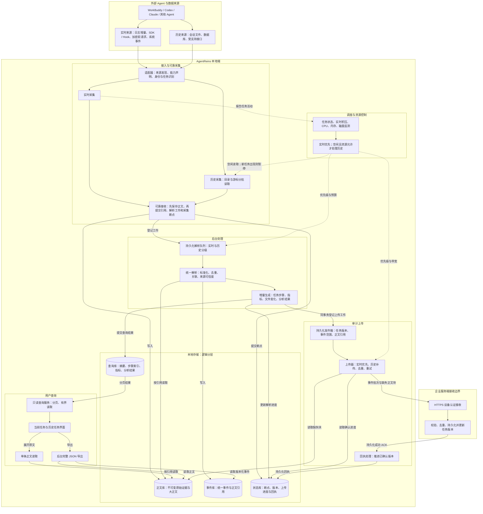

# AgentReins 本地端架构设计与决策说明

版本：V1.0 · 2026-09-24  
状态：架构评审稿，作为后续实施依据，不表示所有能力已交付  
适用范围：本机多 Agent 接入、实时采集、历史整理、本地查询及企业审计上传  
读者：产品、客户端开发、服务端开发、测试及企业安全管理人员

## 1. 设计结论

AgentReins 应当采用“实时优先、后台增量处理、查询直接读结果、上传按版本确认”的本地架构。

核心原则是：**把计算从用户点击历史任务的路径中移出去。**原始证据继续完整保留，但不再要求界面每次加载原文、重新解析、重新关联、重新生成整个任务。

用户提出的四项要求是本设计的起点：

1. Agent 有当前任务时，优先处理当前任务。
2. 没有当前任务时，以低优先级、小批量方式整理各 Agent 的历史任务。
3. 下次查看历史，读取已经解析好的数据，而不是重新处理原始数据。
4. 当前任务优先上传；空闲时补传历史，已经确认的相同版本不重复上传。

本设计不是通过减少证据来换取性能，也不是简单更换数据库。目标是在保留证据可追溯性的同时，使查询成本主要取决于当前页或当前证据，而不是整个历史库的大小。

## 2. 为什么需要重新设计

### 2.1 产品要解决的两个问题

- **Agent 使用者：**理解任务做到哪一步、模型收到什么和返回什么、工具做了什么、改了哪些文件，以及时间和 Token 消耗是否合理。
- **企业管理者：**核对敏感数据读取与外发、模型和中转节点、MCP 与工具调用、记忆使用及变更，保留可追溯的审计证据。

这两类用户需要的是可直接查询的事实和关联结果。原始 JSON 是证据，不应成为用户理解整个过程的唯一入口。

### 2.2 当前问题及证据边界

代码检查已确认：本地已经存在原始证据、解析事件、统一事件和部分分析结果，并非“完全没有处理就入库”。但历史详情仍通过读取任务事件、JSON 解码、构建会话，再生成任务快照的方式提供数据。

检查位置：

- `Sources/AgentReins/EventStore.swift`：`loadTask`、`loadRecentTasks`。
- `Sources/AgentReins/EvidenceDatabase.swift`：事件存储、任务摘要、索引与查询。
- `Sources/AgentReins/AgentTaskJSONExport.swift`：任务快照及关联结果构建。
- `Sources/AgentReins/AuditUploadClient.swift`：上传队列与重试。
- `Sources/AgentReins/AuditBlockProtocol.swift`：内容寻址分块协议。

已发现或修复过的路径包括：历史列表全表分组、共享锁下的重读取、正文重复存储、详情重复携带完整快照、单个失败任务阻塞上传，以及大 JSON 反复编码上传。

2026-09-24 的一次只读检查中，本机 `evidence.sqlite3` 约为 1.5 GB；这只是当时文件大小，不代表有效数据量、容量上限或性能测试结果。历史摘要回填标记当时尚未建立，首次历史查询仍可能承担迁移工作。

因此，“历史查看会卡”的具体耗时占比仍需要分段测量，不能把所有问题直接归因于 SQLite 或磁盘。已确认的架构缺陷是：**交互路径承担了过多数据重建工作，数据增长会放大这种成本。**

## 3. 范围与非目标

本期设计覆盖本地多 Agent，企业云端先以十台终端试点。云端在本图中只展开认证、接收、持久化和回执边界。

本期不承诺：千台规模容量、多租户隔离完整实现、所有 Agent 内部行为可见、完整隐式推理过程、通过连接记录证明下游服务实际查看或保留了数据。

“思考”只展示真实采集到的推理字段或说明，并明确来源；缺失不能补造。采集覆盖、关联可信度和安全判断必须分开表达。

## 4. 目标架构

下面为目标设计，非当前部署拓扑。实线表示数据流，虚线表示调度控制。各组件是逻辑模块，不要求独立进程或微服务。

### 4.1 正常实时路径

接入适配器获取增量 → 原文可靠落盘 → 登记解析工作 → 标准化事件 → 增量更新可查询结果 → 界面读取结果，同时登记上传工作 → 服务端确认后更新本地上传进度。

昂贵的语义分析可以独立排队，不能阻塞基础事件和步骤的可见性。尚未完成的分析显示“待分析”，以后追加带版本的结果。

### 4.2 历史路径

历史来源先建立轻量目录和进度，再按来源分批读取。实时任务存在时暂停后台历史读取与处理；空闲后续跑。各 Agent 公平轮转，避免一个大历史文件长期阻塞其他 Agent。

优先处理尚未解析或源版本变化的数据，而不是每次重新扫描所有历史正文。外部源被删除或轮转且无法恢复时记录缺口，不声明完整。

### 4.3 查询路径

列表读任务摘要；详情首屏读任务概况和一页步骤；展开模型请求、工具结果或文件变更时，读取对应结构化明细及必要正文。页面不得通过展开一个任务隐式触发全任务重算。

用户选择尚未解析的任务时，可申请提高后台整理优先级，但仍受实时任务优先和资源预算约束。界面显示处理状态，而非假装数据为空。

## 5. 数据模型与存储决策

### 5.1 为什么继续使用本地 SQLite

本地首先需要嵌入式部署、事务、索引和可恢复性。初期不引入本地 PostgreSQL、ClickHouse 或消息中间件。SQLite 是否满足性能目标，应通过本机负载测试判断；不能用换库代替消除全量读取和重复计算。

采用单写入协调器、小事务和独立只读连接，避免应用层共用大锁把所有读写串行化。WAL 不代表读写完全无干扰：长读事务、检查点和磁盘吞吐仍需监测。

### 5.2 四层数据

| 逻辑层 | 建议内容 | 不应承担的工作 |
|---|---|---|
| 正文库 | 内容哈希、原始字节、完整性信息、可选压缩及长度 | 历史列表直接遍历正文 |
| 事件库 | 稳定事件 ID、来源、任务关联、时间、结构化字段、正文引用 | 每个投影重复内嵌同一段正文 |
| 查询库 | 任务摘要、步骤、请求索引、工具与文件索引、指标、分析结果 | 用户点击时重新运行全套解析 |
| 状态库 | 各阶段断点、源代次、解析版本、数据版本、上传回执 | 用一个“完成”布尔值代替各阶段状态 |

这些层可以是同一 SQLite 的不同表；大正文可保存在专用文件目录。是否启用正文压缩及块大小须通过样本测量确定，不能把每个小字段拆成一个文件和一次上传请求。

正文引用复用相同字节，不代表不同调用事件合并。两次相同请求仍是两个事件，可共享正文引用，但必须分别保留时间、调用身份和关联。

### 5.3 字段处理顺序

本阶段先沿用各 Agent 现有采集字段、原始记录和统一事件结构，完成实时优先调度、历史后台整理、查询结果持久化及版本化上传等架构工作。只在实现这些能力所必需时增加兼容字段，并保持现有采集数据可读取。

逐字段的数据字典、索引规划和展示映射安排在整体架构代码完成后进行。该阶段再逐一确认来源、类型、空值语义、关联依据和页面用途；本设计当前不冻结具体业务字段清单。

## 6. 可靠性与一致性

### 6.1 采集断点

1. 原文块临时写入，完成校验与持久化后原子发布。
2. SQLite 事务登记正文引用、待解析工作及对应采集断点。
3. 事务成功后才推进内存断点。

文件与 SQLite 不能直接组成同一事务，因此采用“先持久化块，后提交引用”。中断最多产生未引用块，由安全回收流程处理；不能产生指向未持久化正文的有效引用。仅原子重命名不等于断电持久化保证，文件、目录同步与 SQLite 同步策略需明确测试。

### 6.2 解析与结果提交

纯解析在写事务之外执行。一个有界批次的统一事件、查询结果、解析进度及对应发件箱记录，在同一个短事务中提交。重复执行使用稳定键幂等处理。

耗时分析单独生成结果版本，并原子登记其上传工作。不得在长事务中调用模型或网络服务。

### 6.3 上传确认

采用至少一次传输、服务端幂等接收，不宣称网络层严格一次送达。以设备、任务、版本、批次及内容摘要识别重试；同版本不同内容作为冲突处理，不静默覆盖。

ACK 丢失时重传原批次；服务端返回原回执。缺块先补块；旧版本不得覆盖新版本；离线时本地继续记录并累计待传工作。单任务永久错误进入可见的待处理状态，不阻塞其他任务。

## 7. 调度设计

| 优先级 | 工作 | 说明 |
|---|---|---|
| P0 | 实时采集与可靠落盘 | 避免证据丢失，持续运行 |
| P1 | 当前任务解析、基础投影和增量上传 | 保证过程及时可见 |
| P2 | 用户明确请求的历史查询、指定任务整理 | 查询有界；整理仍可暂停 |
| P3 | 自动历史读取、解析、补传 | 仅在没有活动任务、实时积压清空且资源允许时运行 |
| P4 | 索引维护、历史重解析及安全回收 | 维护窗口和独立预算 |

优先级不是允许高优先级任务无限占用资源；所有工作仍需批次上限、取消点和背压。

“空闲”由原生开始/完成信号、活动事件、实时队列及系统资源共同判断。进程存在不等于有任务；短时没有日志不等于任务结束。状态不确定时采用保守预算，界面保留“不确定”。

历史批次同时限制事件数、读取字节数、处理时间与内存。新实时任务到来后，不再派发历史批次；当前批次在安全取消点退出并保存进度。长期持续有实时任务时，历史可以延期，但应展示积压，不能偷偷放宽用户设定。

## 8. 上传设计与现有版本衔接

已部署的 v2 是内容寻址分块：支持缺块探测、补传、去重和任务版本确认，但客户端仍构建快照，服务端仍在 commit 时组装校验。它解决的是传输与存储重复，不是完整的事件流处理架构。

目标是上传“事件批次 + 正文引用 + 任务版本”，服务端增量更新查询结果，安全检测和未来 RAG 通过独立后台消费者处理新增数据。完整 JSON 仅在导出、核对等明确需求下组装。

历史补传是新要求，与此前“只上传启用之后的新任务”的部署策略不同。必须增加明确的历史范围与授权配置，并同步调整服务端范围校验；不能只移除时间判断就把所有本机历史上传。

建议上传策略包含：选定 Agent、历史起止范围、允许的数据类别、目标企业和设备身份、带宽预算。界面显示待传、传输中、已确认和失败状态。历史任务已经确认的相同版本不重传；有补采或修订时只追加新版本及缺失正文。

## 9. 安全、留存与运维

- 原始证据与解释并存；事实、推断和策略结论分开保存。
- 本地正文、数据库和队列使用受限权限；凭据进入系统安全存储，避免混入证据、日志或代码仓库。
- 企业端通过 HTTPS 和设备认证接收；读取原文需要相应权限并记录访问。完整证据访问不等于向所有角色默认公开。
- 留存、删除和脱敏属于显式组织策略；本设计不默认删改原文。备份与导出采用同等权限控制。
- 正文清理必须验证无有效引用、不在未确认上传中、符合留存策略，不能按“文件旧”直接删除。
- 磁盘低水位暂停历史读取、处理和补传，告警并优先保障实时采集；最终无法保存时明确暴露采集缺口，不继续推进断点。
- 备份覆盖数据库与已引用正文，形成一致版本；恢复后校验引用完整性并恢复队列。

## 10. 方案取舍：为什么不选其他方式

| 方案 | 优点 | 主要代价 | 决策 |
|---|---|---|---|
| 查看时解析原文 | 初期实现简单、随时用最新逻辑 | 响应随任务体积增长、反复计算、用户承担失败与等待 | 不作为正常查询路径 |
| 每任务保存并反复上传大 JSON | 便于单文件导出与人工检查 | 重复正文、反复编码、修改与重试成本高 | 保留为导出形式 |
| 立即换大型数据库 | 可获得更多服务端能力 | 不消除全量重建，增加本机部署维护负担 | 本地暂不采用 |
| 每个字段单独分块上传 | 去重粒度细 | 文件数、索引和网络往返可能膨胀 | 合并小对象、有界批次 |
| 统一事件加预生成查询结果 | 查询可预测、可复用、适合持续分析 | 增加版本、迁移和一致性设计成本 | 目标方案 |

## 11. 实施路线与发布门槛

开发顺序以整体架构为先：先让处理、查询和上传遵循分层及调度原则，之后再逐字段细化数据库结构与展示映射。实现中优先复用当前采集字段，避免在架构主线完成前扩展字段清单。

### 阶段 A：测量和查询解耦

记录列表查询、事件读取、解码、投影生成、分析、渲染的耗时、字节和峰值内存。建立可持久化查询结果与分页接口，移除用户点击触发的全量迁移。旧数据通过后台任务回填。

### 阶段 B：实时增量处理

建立有界事务、统一版本、可靠解析队列和独立读取连接。实时任务每批提交可见结果，不等待任务结束或昂贵分析完成。

### 阶段 C：历史调度

建立来源目录、可恢复断点、多 Agent 公平轮转、暂停恢复及资源预算。先验证本地整理，不把历史整理自动等同于历史上传授权。

### 阶段 D：事件批次上传

引入事务发件箱和服务端事件幂等接收；保留 v2 兼容迁移路径。确认历史补传配置与服务端授权后开启补传。先服务端、后客户端，逐步验证。

### 阶段 E：留存与容量验证

实现正文引用回收、配额、磁盘告警、一致备份恢复，以及十台终端试点。没有完成这些，不宣称长期无人值守或千台规模就绪。

数据库采用添加式迁移、按任务切换读路径，不全量启动扫描。新旧来源读取和上传队列切换要有单一所有者，避免双重处理。回滚前检查结构与队列兼容性，不能直接启动旧客户端消费旧队列。

## 12. 验收标准

以下时延为建议目标，需在基准设备、样本体积及并发条件冻结后确认，不是当前实测承诺。

| 场景 | 正确性与性能验收 |
|---|---|
| 历史列表 | 每页最多 20 条；不读取正文；建议本地查询 P95 ≤200 ms |
| 已解析任务首屏 | 只读概况和一页步骤；不重新解析源文件；建议 P95 ≤500 ms |
| 单条证据 | 只读所选正文；超大正文分段呈现，完整导出不截断 |
| 新实时任务到来 | 不再派发历史工作；建议历史任务在 1 秒内到达取消点并让出，采集不断流 |
| 历史增长 | 1 千、1 万、10 万任务分级测试；记录冷缓存、热缓存及页面读取字节，不能只比较平均耗时 |
| 大任务 | 测试大量事件和大正文；首屏内存不随完整任务正文线性增长 |
| 崩溃恢复 | 在正文写入、事务提交、解析和 ACK 前后注入中断，无静默漏采、无错误确认 |
| 上传重试 | 同批次重传不重复计数；旧版本不覆盖新版本；ACK 丢失可恢复 |
| 历史补传 | 严格限制授权范围；已确认相同版本不重复上传；实时恢复后历史暂停 |
| 源文件轮转 | 正确区分来源代次，不能拿旧偏移跳过新文件 |
| 磁盘与离线 | 历史停止、实时优先、状态可见；不可保存时明确报告缺口 |
| 十台试点 | 记录上传延迟、待处理积压、客户端 CPU/内存/IO、服务端内存、日磁盘增长与恢复时间 |

必须同时监测：最旧待处理任务年龄、各来源处理进度、解析失败数、上传确认延迟、正文去重率、读取字节、写事务时长、WAL 增长和主线程阻塞。

## 13. 关联资料

- [现有上传 v2 协议及边界](../AgentReinsConsole/UPLOAD_PROTOCOL.md)
- [现有总体架构资料](ARCHITECTURE.md)
- [现有采集架构资料](DATA-COLLECTION-ARCHITECTURE.md)

本设计是本地端重构的评审依据，与上述实现说明共同阅读；发生差异时，应明确标注“当前实现”和“目标设计”，不得以设计文档替代交付验证。
