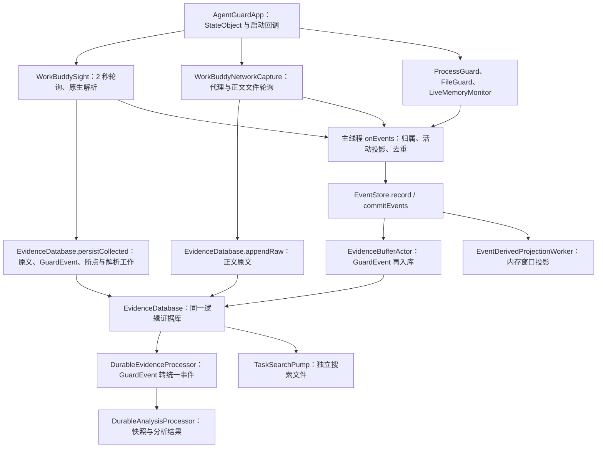
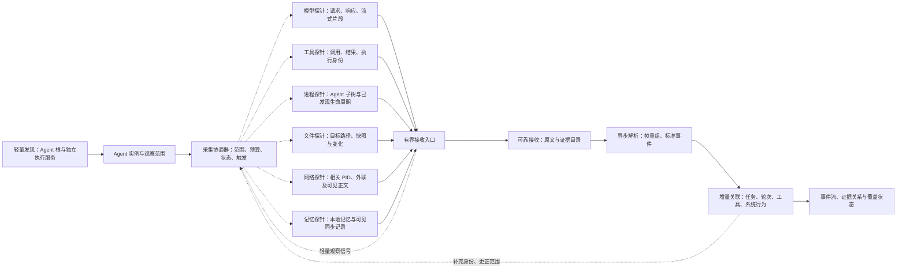
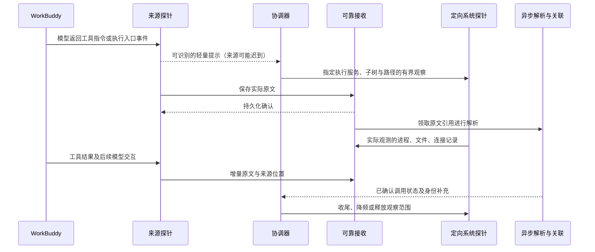

# AgentReins 实时采集架构 V3：协调器与定向探针

日期：2026-10-04。状态：讨论稿，未经架构验收，不代表已经实现。

依据：原仓库 `/Users/jatsmith/AgentSpec/AgentGuardApp`，基线提交 `e838fb5`（2026-09-25），以及当前工作副本的采集修复。此次修订先审阅原有架构、验收报告与实际调用路径，再引入协调器设计。原仓库只读，本轮只修订文档。

参考文档：

- [原总体架构](ARCHITECTURE.md)与[原采集架构](DATA-COLLECTION-ARCHITECTURE.md)：原生语义与系统独立观测、来源可替换、保守关联。
- [原采集可靠性评估](COLLECTION-RELIABILITY-ASSESSMENT.md)与[9 月 11 日验收](COLLECTION-ACCEPTANCE-2026-09-11.md)：采样盲区、断点、性能与真实参考工作负载。
- [本地架构 V1](LOCAL-AGENT-ARCHITECTURE-V1.zh-CN.md)与[持久化流水线 V2](LOCAL-PIPELINE-ARCHITECTURE-V2.zh-CN.md)：阶段解耦、原文与断点、独立消费者、单写入及预算。
- [9 月 25 日流水线报告](PIPELINE-TEST-PLAN-AND-REPORT-2026-09-25.zh-CN.md)：已验证契约与未执行项；历史测试结果不能自动当作本次改造的验收。
- [本轮定向进程采集修复](v2/scoped-process-collection.md)：不使用 ESF、进程启动身份与采样边界。

本文承接原架构，不新建替代采集器、不依赖 AppLens、不重做展示、不做 Windows。本期不扩展历史恢复；原历史查询/整理机制保留，实时采集预算优先。

## 0. 原架构与代码审阅结论

### 0.1 原设计已经具备的能力

“原生记录说明意图，系统观测核对行为，再用保守关联连接二者”来自原采集设计，不是本轮新发明。`07f8d3f` 分离进程与网络调度，`78eb6b1` 增加持久化证据基础，`41c0258` 做短期采集验收；后续 V1/V2 与 `e838fb5` 引入持久解析、任务快照、索引及安全输入流水线。应保留这些经过积累的机制。

原报告的一秒进程测试曾观测 20/20，不证明 20ms 进程完整；短连接和快速文件中间变化当时就明确未通过。V2 文档中的独立后台服务、字节背压和完整单写调度仍是目标，不能因为已有 actor/SQLite 表就视为全部交付。

### 0.2 真实运行路径（原基线代码）

这是代码调用关系，不表示每条事件重复计数。`GuardEvent` 同 ID 的原生版本与后补归属版本可能是有意的修订；改造应保留富化能力，不能用内容相同就删除证据。原生 JSON 解析和后续统一事件投影是不同阶段，也不能简单称为“两次重复解析”。但回调链上的编码、写入、投影与队列占用需要分别测量。

### 0.3 逐模块保留与调整

| 既有模块 | 已确认职责/问题 | 设计决策 |
|---|---|---|
| `AgentGuardApp.swift` | 创建采集 StateObject，设置回调并启动；生命周期依附 App | 保留应用壳，将采集所有权逐步转移至后台运行时，UI 不拥有探针 |
| `WorkBuddySight.swift` | 增量文件与 ParserState；在 `readRecentEvents` 中解析，随后 `persistCollected`；每批选一个变化文件 | 保留格式解析、原生 ID、工具名称状态及断点；逐步将原文接收与语义解析分开；多活跃来源轮转，防止一个持续变化文件挤占另一会话 |
| `WorkBuddyNetworkCapture.swift` | 原文先保存；网络身份归属在回调中补齐；运行时 offset 从零开始；代理运行不代表目标流量已接入 | 保留正文适配器和归属机制；优先验证真实请求，再统一接收位置、分片和处理确认，不靠反复全文件重读保证可重放 |
| `ProcessGuard.swift` / `ProcessSnapshotProvider.swift` | 独立进程/网络节奏；libproc 根发现与子树采样，已有降频发现策略 | 保留；协调器只接管范围和预算。变化通知是待验证增强，不替换已知有效的扫描路径 |
| `NetworkSnapshotProvider.swift` / `ProxyDestinationProvider.swift` | PID socket 与代理目的地址元数据，不能提供完整正文 | 保留为独立系统证据，不和模型正文探针混为一条能力 |
| `FileGuard.swift` | 配置路径轮询、备份、规则与还原，兼有保护职责 | 保留保护行为；将变化采集接入共享范围，保护处置不能被无限延期的分析队列饿死 |
| `LiveMemoryMonitor.swift` | 已知记忆文件建立基线、1 秒轮询与变化事件；当前 snapshot 每轮可再次读入未变文件正文 | 保留路径识别与基线；复用变化后的正文，避免未变文件重复读取。超过正文上限不得只留 nil 而不给覆盖说明 |
| `MemoryScanManager.swift` | Python 审计脚本、人工/周期扫描、独立 inventory/findings | 保留为有预算的审计工作，不能让全量审计成为每个任务的实时必经环节 |
| `EventAttributionResolver.swift` / `ToolActivityProjector` | 原生身份与保守工具/系统关联；主线程回调链中运行 | 保留规则与可信度；逐步移入增量关联消费者，和可靠接收确认解耦 |
| `EventStore.swift` | 发布 500 条内存窗口，同时启动解析、分析、回填、索引和写缓冲 | 保留对 UI 的兼容接口；工作所有权移出；500 条是预览限制，不是完整采集账本 |
| `EvidenceBufferActor.swift` | 按事件数/时间批写；失败批次暂存在内存；一次 flush 会取走所有 pending | 复用批写思路，改为有字节上限与持久待办；“actor 串行”不等于持久队列或有界内存 |
| `EvidenceDatabase.swift` / `EvidenceReadConnection.swift` | WAL、原文哈希链、断点、解析租约、顺序、独立只读连接 | 保留存储与事务，不换库。共享连接修复基础上补优先级写调度；保持租约栅栏与版本语义 |
| `DurableEvidenceProcessor.swift` / `DurableAnalysisProcessor` | 已有持久工作与隔离；解析 actor 做标准化投影，分析生成任务快照 | 保留工作契约；为实时解析分区与大正文安排有界预算，补原文解析阶段而非另造不兼容事件流 |
| `EventDerivedProjection.swift` / `TaskSearchPump` / `BackgroundSecurityQueue` / 上传器 | 已有独立投影、索引、安全及上传进度；并非全部共享一个 SQLite 文件 | 保留消费者边界；测量重建范围，合并可重复投影；不因接入协调器删除既有查询/上传能力 |

### 0.4 这次发现与原设计之间的具体差距

1. reasoning 原文已存在，却因解析字段回退错误未形成事件：问题在适配器兼容与覆盖核对，不是没有流式队列。已修复的解析器继续复用。
2. 网络正文来源未更新：首先是来源接入问题，添加协调器/队列本身无法获得看不见的正文。
3. 工具日志可能迟于执行，系统采样可能错过短进程：需要独立基础观察和有界触发增强；不是仅从模型工具指令补造执行事实。
4. 多模块原先各建写连接、健康回调在主线程等待、历史解析查询占用长写事务：本轮已经做部分修复；设计需落实调度与容量，不应再次只写“SQLite 单写”。
5. 当前任务曾因启动时间过滤而为空：这是投影资格问题，不能等同于源数据丢失。采集延迟、解析覆盖与呈现状态分别验收。
6. 已有记忆监测可证明部分本地变化，但不证明云端同步或完整请求注入。保留现有来源，补实际正文与版本关系。

### 0.5 本轮新增职责仅三项

- **CollectionCoordinator**：复用原 Agent 发现与各适配器，登记实例、来源状态和观察范围；不再把启动职责放进 UI。
- **ObservationScheduler**：接管原 Timer/队列配额，合并局部加强窗口、公平调度活跃来源、限制开销。
- **CollectionIngress**：接到原 EvidenceDatabase/EvidenceBuffer 的可靠接收与提交调度；确认原文和工作持久化后才 ACK。

这三项是新增逻辑边界，不要求三个新进程。其余原解析器、事件协议、关联器、持久消费者按适配接口迁移，继续使用旧记录与测试。迁移期每个来源只有一个消费/游标所有者，不能同时跑旧 Timer 和新协调器造成双重采集。

## 1. 本期要解决的问题

一次 WorkBuddy 任务中，能够说明每轮给模型什么、返回什么、调用什么工具、实际产生哪些系统行为，以及哪些部分没有观测能力。通过原文与事件对照验收，不以页面有动画或数据库有记录作为完整采集的证明。

已发现的问题分三类：

| 问题 | 实例 | 处理方向 |
|---|---|---|
| 来源未接通 | 网络正文文件长期未新增；进程网络快照不能代替模型请求正文 | 分来源能力自检，优先打通完整模型请求 |
| 已接收但解析遗漏 | reasoning 的空 content 遮住非空 rawContent；文件快照未形成对应事件 | 原文独立保留、解析覆盖核对、指定范围重放 |
| 触发迟、处理互相阻塞 | 轮询看到调用时子进程可能已退出；实时与补录争用资源 | 定向采集、轻量触发、短事务和资源配额 |

本期不用 ESF，不引入 Kafka，不宣称轮询能完整捕获所有短进程、短连接或文件读取。

## 2. “蜘蛛”对应的真实架构

一只逻辑蜘蛛代表一个 Agent 实例；同一 Agent 的多个任务复用原有适配器，通过任务与执行身份区分。后台服务管理多只蜘蛛，机器级轻量发现器和写入器共享，不能每个任务各扫一次全机。

身体是采集协调器，手是专门的数据源探针。这里的“探针”是既有适配器/系统采集器的逻辑称呼，不是六个重新开发的模块。协调器既接收数据，也控制观察范围和强度。它不负责在接收回调里解析大正文、做安全分析或重建完整任务。

虚线控制的是“去哪里看、看多久、预算是多少”，不表示推断出了实际执行证据。一次观察信号可以触发多只手，但不能制造一条不存在的进程或网络事件。

## 3. 六类探针及其能力边界

| 探针 | 第一阶段来源 | 要保留的内容 | 触发与范围 | 不能据此证明的事情 |
|---|---|---|---|---|
| 模型 | 已接通的正文接口/受控代理、Agent 本地 trace；会话日志作为补充 | 原始请求/响应字节、请求标识、目的服务、分片与结束信息、可见 reasoning | 持续接收；限定目标 Agent 可辨识流量 | 用户消息等于完整请求；TLS socket 能看到正文；可见 reasoning 是全部内部思维 |
| 工具 | 本地原生调用记录；受支持的执行入口待验证 | 调用 ID、名称、完整参数、结果正文、状态、时间、可见 PID | 新调用提高相关范围预算；完成或超时后结束观察窗口 | 工具要求执行的命令已经启动；内部脚本没有额外子进程 |
| 进程 | libproc；已发现 PID 的本机生命周期通知需验证 | PID、启动时间、PPID、路径、相关参数、观测时间、来源 | 低频发现根，高频定向子树；变化通知作为加速提示 | 每个 fork 都能拿到 child PID；所有极短进程都被捕获；快照消失就是确定退出状态 |
| 文件 | 工具参数/结果、源文件快照、限定目录变化通知 | 路径、变化前后引用、哈希、观察时间、可得执行身份 | 仅订阅工作区、被调用路径及相关记忆路径；内容按变更读取 | 目录变化通知能证明某 PID 读取文件；所有临时文件和读操作都可见 |
| 网络 | 指定 PID socket 快照、已接通代理或正文来源 | 本地/远端地址、PID 身份、请求 ID、可见正文与连接状态 | 只采 Agent 子树；网络工具窗口内局部加强 | 所有短连接被采到；工具 URL 等于实际连接；代理监听等于目标流量接入 |
| 记忆 | 记忆文件变化、工具访问、可见同步请求、模型请求中的片段 | 读写或同步内容引用、记忆版本、请求中的实际片段 | 配置范围内的记忆来源；正文到达后识别记忆片段 | 云端保存完整项目；模型使用了请求中没有体现的记忆；内存缓存都能读取 |

内存数据暂不作为第七只持续扫描的手。已有受控观测可保留其来源，但不默认全机内存扫描/转储。是否需要专门探针，由完整请求通道无法覆盖的具体问题及权限、开销测量决定。

每个探针必须报出：支持什么、已经连接什么、最近实际收到什么、是否积压、有哪些已知缺口。无新事件不一定故障；有新任务却缺少对应证据时，结合其他来源检查通道。

## 4. 协调器：接收数据与调度观察分离

### 4.1 接收路径

探针提交带字节预算的原始批次，协调器校验来源身份和长度，交给可靠接收层。大正文以引用流转，不在多个队列复制。接收确认只在原文持久化且目录事务提交后返回。UI、解析消费者、工具触发器均不能提前推进来源断点。

轻量识别器可以提取来源已有的请求 ID、调用 ID、PID 或帧头，生成观察提示；对于没有明确边界的数据，不在接收线程做全量 JSON 解码来找提示。提示失败只影响调度效率，不应丢弃原文；提示本身不是完整解析确认。可持久化、可恢复的调度工作由解析后的标准事件登记。

### 4.2 调度路径

| 模式 | 行为 | 进入条件 | 结束条件 |
|---|---|---|---|
| 待机发现 | 低频发现 Agent 根和执行服务，维持必要来源监听 | Agent 未运行或无明确执行活动 | 发现 Agent/执行事件 |
| 常规跟踪 | 增量读取原生来源，采 Agent 子树，接收模型数据 | Agent 运行 | 工具提示或来源变化 |
| 局部加强 | 提高相关执行服务与子树采样，跟踪指定路径和 PID | 调用、进程变化、目标目录变化等提示 | 完成、无活动或预算期限到达 |
| 收尾 | 有界补读输出与相关变化，接受迟到事件 | 工具完成或超时 | 收尾期限到达 |
| 背压 | 降低可重放来源拉取速率，暂停可延期处理 | 接收/磁盘/CPU 达到高水位 | 降到恢复水位 |

不能仅等待工具日志触发：日志可能迟写，因此保留子树的基础观察。也不能根据模型说“将执行命令”便登记已执行进程；这种信号只允许预先打开观察窗口。

每次加强请求带范围、理由、截止时间、最大工作量。重叠窗口合并，采样频率取需求中的最高值但不得超过总预算；一个调用不能留下永久高频扫描。并行任务共享底层进程扫描，再分别做关联，不重复调用 libproc/lsof。

### 4.3 单个工具调用的流转

如果探针收到调用时子进程已经退出，该范围记录触发延迟；不能补造 PID。执行入口直接提供 PID/退出状态时保留原始身份，否则工具结果与进程记录只是不同证据来源。

## 5. 无 ESF 的进程采集设计

现有 libproc 路径作为第一阶段基础：启动和每 30 秒轻量根发现，750 毫秒 Agent 子树轮询。这是当前实现参数，不是最终性能目标。初始发现不读取/保存无关进程参数；独立服务作为有来源依据的额外根，不能只按 node/Electron 名称认作 WorkBuddy。

待验证增强：对已经发现的 PID 注册进程变化通知，收到提示后立即安排局部子树扫描；通知标志、权限、派生语义和开销须在目标 macOS 实测。不得把父 PID 的 fork 提示描述成完整子 PID 事件流。已发现 PID 的退出通知也不能恢复尚未见过的短进程。

跟踪身份使用 PID + 启动时间，启动实例和 exec 图像变化分别处理。PID 复用不能继承旧归属；进程脱离原父树后，保留已知身份直到结束，未识别的独立服务由低频发现补入。父子信息不足或 PID 不可查询时标注缺口，不建立确定边。

极短进程的兜底候选是受支持的工具执行入口：直接记录 spawn 返回的 PID、命令与退出状态。是否能接入 WorkBuddy 现有执行服务，是独立可行性验证项。PATH 包装只覆盖经过包装的可执行文件，不能当作全覆盖；不默认注入第三方进程，不要求禁用 SIP，不修改其沙箱行为。

## 6. 事件与因果关系契约

原始事件信封至少包含：

- 采集实例与版本、设备及 Agent 实例、探针、来源能力状态。
- 来源流 ID、代次、字节位置或来源序号；正文引用、字节数及哈希。
- 来源时间、接收时间、单调时钟时间（同采集实例内比较），时间精度。
- 实际可得的会话、任务、请求、工具调用 ID；未知时为空。
- 实际可得的 PID、进程启动身份、PPID、连接或文件身份。
- 分片类型/顺序、是否结束、是否截断、解析版本与覆盖缺口引用。

不用接收时间替换来源时间。两台设备的单调时钟不能直接比较。内容哈希用于校验/正文去重，事件身份还包含来源位置或原生 ID；内容相同的两次调用不能合并。

关联优先级：原生明确标识 → 执行入口传递的身份 → 同一已验证进程/连接 → 有界时间与内容匹配。后两类按实际依据标注可信度，多个候选时保留未关联状态。进程父子关系也不等于确定工具归属。后补关联通过修订追加，原文不覆盖。

记忆作为内容类别及来源关系处理：同步到本机、读入上下文、进入模型请求分别是不同事件。将某片段归类为记忆要有文件/同步版本、标记或内容对照依据，模型提示中泛称“背景”不能自动确定为云端记忆。

## 7. 沿用 V2 的持久化流水线

| 阶段 | 确认契约 | 禁止事项 |
|---|---|---|
| A：原文接收 | 正文可靠保存；证据引用、解析工作和接收位置同事务提交 | 保存失败推进游标；半帧被当成完整解析 |
| B：解析 | 在事务外重组帧和解析；事件、解析状态、下游工作及租约确认同事务提交 | 大正文解析占用写事务；解析异常静默跳过 |
| C：关联/投影 | 消费已提交事件，关联修订与消费进度同事务提交 | 每次新事件重建整个任务；把推断写成确定关系 |
| 查询/检测/上传 | 独立进度、独立预算，按引用读取必要正文 | UI 参与采集确认；检测阻塞接收；上传开启改变采集语义 |

本机保持一个受调度的写入入口，提交短事务，原文文件先持久化再发布引用。当前“各模块共享数据库连接”只是过渡，尚不等于实现了有优先级的单写调度器。

目标部署沿用 V2：用户会话后台采集服务与桌面 UI 分离。关闭窗口不停止采集；采集实例是否存活可独立验证。当前仍有探针生命周期依赖 App 的实现，必须先解决，不能再在采集进程未启动时让用户发任务验收。

## 8. 资源预算与背压

不预先承诺 CPU/内存百分比。先固定工作上限，再在目标 Mac 上测量和调整：

| 资源 | 约束 |
|---|---|
| 接收队列 | 按累计字节及最老等待时间控制，不能只限制事件条数；每探针有配额及公平调度 |
| 大正文 | 以持久引用流转，分片接收；超过单批预算转为分块，不静默截断 |
| 写事务 | 有条数、字节与时间预算；接收优先但为实时解析保留进展，避免低优先级永久饥饿 |
| 解析 | 初始单消费者，各来源轮转；输入大小和时间均限额，有状态来源保持顺序 |
| 系统扫描 | 一个共享调度器；合并重叠 PID/路径范围；限制同时加强的范围及持续时间 |
| 历史/检测/上传 | 独立低优先级预算，实时高水位时让步；本期不新增历史恢复 |
| 磁盘 | 配置接收空间与高/低水位；故障时保存缺口，不能靠无限内存缓存承诺无损 |

可重放来源：先减速拉取，不确认未持久化数据；不可重放来源：预留可靠接收空间，超限明确记录时间范围和丢失原因。进入/退出背压用不同水位避免抖动。内存中尚未落盘的内容不能算采集成功。

每个加强窗口的初始参数、队列大小、正文块布局及 CPU 目标均为待测量决策，不在讨论稿中伪装成已验收指标。

## 9. 采集自检与覆盖账本

每个任务至少分开记录：来源已产生、已接收、已解析、已关联、来源能力缺口。没有可靠来源总量时不能显示“100%完整”。来源记录数量与标准事件数量未必一一对应，需要按事件类型、原生 ID 和内容对照。

必须测量：来源到接收、接收到入库、入库到解析的延迟；原文队列字节、最老年龄、写锁等待、事务耗时、每探针 CPU 时间/扫描次数、磁盘/WAL 增长、隔离数和明确缺口。

网络正文探针检查“实际新增目标请求”，不只检查端口监听。进程快照只报告所见 PID；文件快照只报告包含的文件条目；reasoning 仅表示来源可见的推理，不声称获得模型未披露的内部过程。

解析器回归必须包含空 content + 非空 rawContent、长文本、未知字段、多个并行调用、半行与日志轮转。这次 reasoning 修复已验证一条真实任务原文与入库的 932 字符一致，不代表所有任务和来源均完整。

## 10. 实施顺序与真实验收

| 阶段 | 内容 | 通过条件 |
|---|---|---|
| 0：基线与来源自检 | 原有用例与固定真实负载建立基线；后台存活、来源接入与能力声明 | 发任务前确认采集运行；正文探针实际收到数据或明确未接通 |
| 1：可靠接收 | 所有探针通过统一入口，原文/断点/解析工作契约 | 失败不推进断点；重启与重试不制造新调用；队列有上限 |
| 2：模型与工具 | 全轮请求、流式响应、reasoning、工具参数与结果 | 原文逐字段/逐 ID 核对；分片重组和结束状态可验证 |
| 3：定向调度 | 进程树、目标文件和网络范围；变化提示可行性验证 | 无关进程不持久化；观察范围与理由可查；短进程缺口如实报告 |
| 4：关联与资源 | 持久消费者、局部关联、背压及性能测量 | 并行任务不误关联；持续负载内存有界；实时接收不被补录挤占 |

真实验收场景：代码编写与运行、文件读取、视频生成、方案生成、记忆读取与后续模型调用；增加并行任务与失败重试。先启采集器，记录来源能力和起始位置，再发任务；执行结束逐项核对原文、进程身份、文件/网络证据，不靠模型自述确认动作。

短进程专项使用可控父程序产生 20ms、100ms、500ms、1s 子进程，父程序独立记录实际 PID/开始结束作为参考，比较定时扫描、变化触发与局部加强的命中率和开销。参考程序是测试依据，不代表第三方 WorkBuddy 已接入执行入口。网络同样使用可控短连接参考记录，避免用工具 URL 代替实际连接。

故障验收：暂停解析、锁住写入、磁盘不足、断开正文来源、半行追加、截断/轮转、重启、PID 复用、调用迟到及不同任务相同内容。每次结果区分“原文完整但解析缺失”“来源不可见”“确认丢失”“尚在积压”。

## 11. 当前实现与目标的距离

| 能力 | 当前事实 | 下一步 |
|---|---|---|
| 独立后台采集服务 | 采集仍主要由 SwiftUI App 启停 | 服务边界与 IPC 生命周期设计、故障验证 |
| 协调器与六类探针 | 多个适配器已有，但没有统一主动观察调度 | 统一入口、范围注册与有界观察窗口 |
| 统一写入 | 复用同一 EvidenceDatabase 连接，已有异步健康写入 | 有预算的提交调度，不在回调里持锁计算 |
| 可靠队列 | 已有持久解析工作；部分归一化缓冲仍在内存 | 原文先接收、字节背压、重启恢复核对 |
| reasoning | 已修复空 content 的 rawContent 回退并做实时回归 | 未覆盖来源结构继续用原文对照；指定范围修复另立工作 |
| 模型完整正文 | 接口代码存在，WorkBuddy 正文通道仍未验证有效 | 首要来源可行性与端到端接入 |
| 工具调用/结果 | 已核对一项真实任务的 4 次调用和 4 次结果 | 验证执行入口、失败/取消/重试与并行关联 |
| 进程 | 定向 libproc，校验启动身份；仍是采样 | 无 ESF 的变化通知可行性及短进程命中率测量 |
| 文件 | 部分保护路径轮询、工具语义；快照解析仍有缺口 | 有范围的变化采集及快照记录，不宣称文件读取全覆盖 |
| 网络 | PID socket 采样与代理实现 | 正文来源接通；短连接覆盖单独验证 |

本轮输出仅为架构讨论稿。先评审既有模块的保留/迁移边界、来源可行性、接收契约和验收标准，再按阶段实施；动画表现留到采集机制成立之后。

迁移与回退：先让一个 WorkBuddy 来源接入 CollectionIngress，旧来源原子交接游标后退出，由同一解析器生成兼容 GuardEvent/统一事件。验证后再接入系统范围调度。保持原数据库可读及原始字节不变，迁移新增字段/工作采用版本化方式；新旧派生版本可以对照，但不能同时推进同一来源断点。回退恢复原采集路径的单一所有权，避免重复执行任务或隐式全库重放。

架构验收不能只跑新增测试：复用原 `TurnJournalTests`、`DurableEvidencePipelineTests`、`PipelineArchitectureAcceptanceTests`、`SecurityEvidenceStreamTests` 与正文协议测试；本轮实际任务对照作为补充，进程缓存退出测试不能替代极短进程召回测试。原报告已通过和未执行的项按版本记录，本次没有重跑全系统验收。
