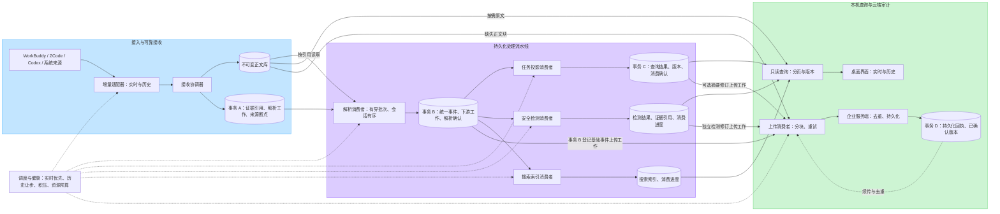
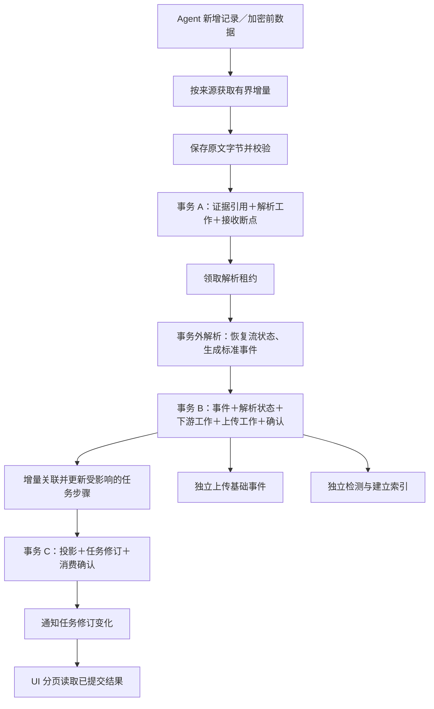
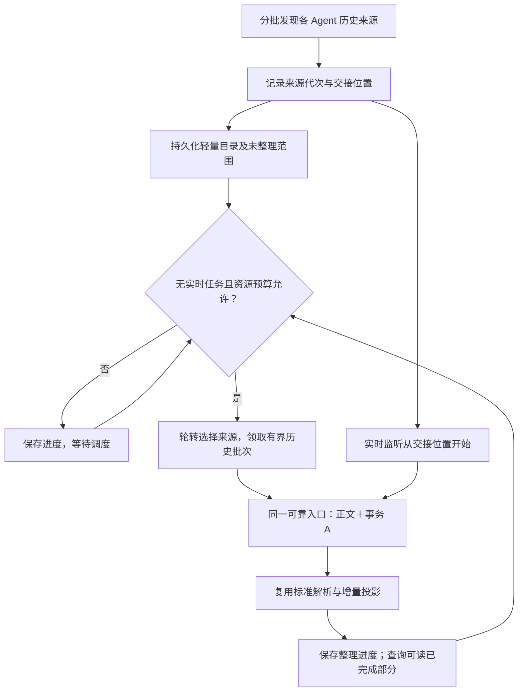
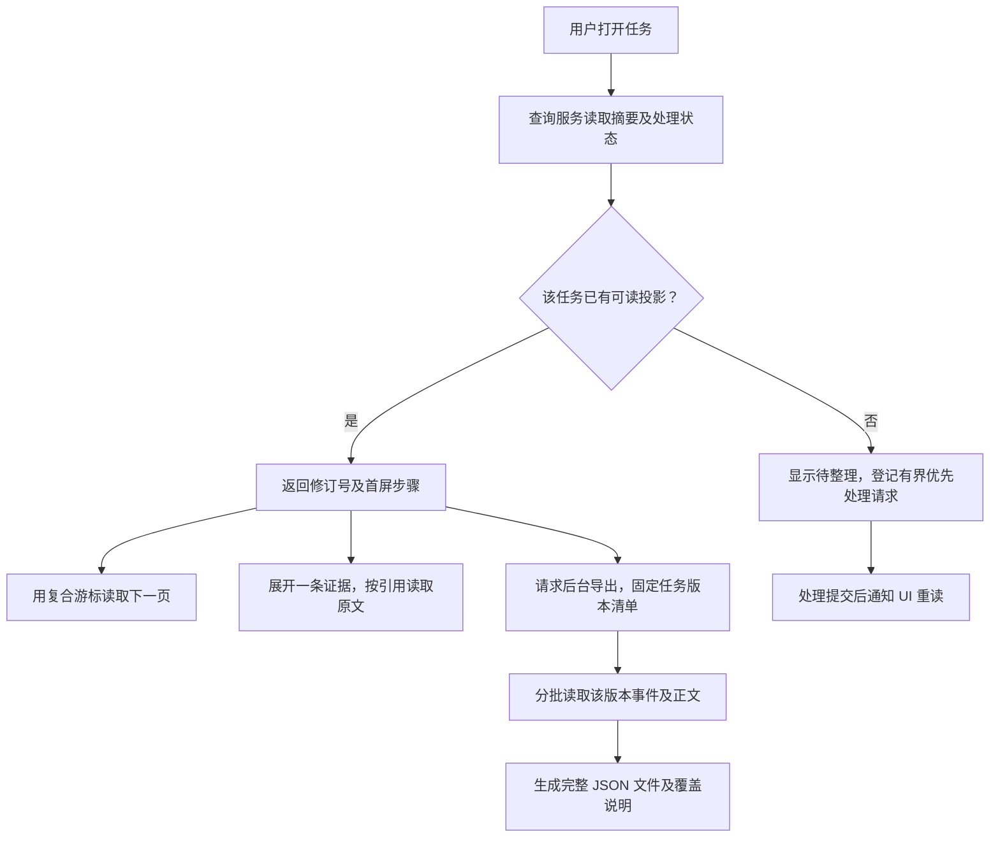
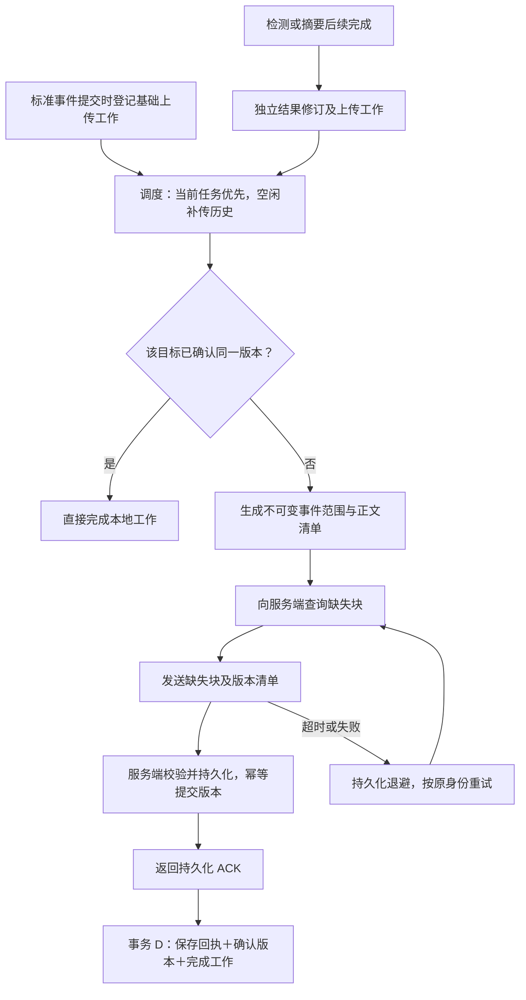
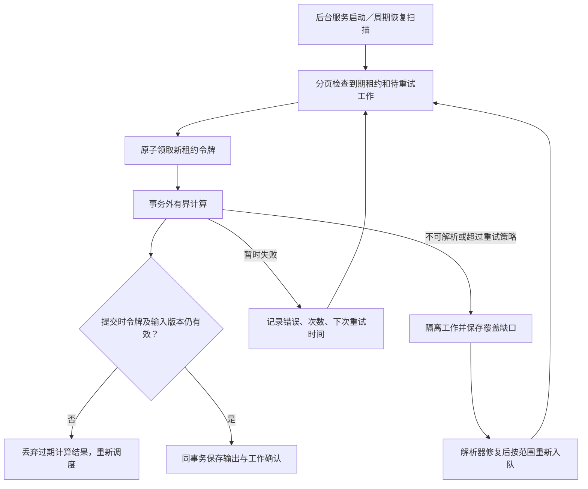

# AgentReins 本地持久化流水线架构 V2

日期：2026-09-24  
性质：目标架构设计，供评审与实施；不代表已部署。  
范围：本机 Agent 接入、证据持久化、解析、关联、查询、安全检测、搜索和审计上传。业务字段沿用现有结构，字段字典另行细化。  
与 V1 的关系：承接 V1 的实时优先、后台历史整理和版本化上传原则，以本文明确阶段契约和恢复机制。

安全分析专项设计：[本机安全分析架构 V3](LOCAL-SECURITY-ANALYSIS-ARCHITECTURE-V3.zh-CN.md)。其中定义真实文章案例、完整证据检查范围、数据传播关系、持久化 AI 分段队列和安全发现验收；其历史保底调度约束优先于本文早期的纯空闲回填描述。

## 1. 设计目标

采集的完成条件是证据可靠接收；解析的完成条件是标准事件及后续工作可靠提交；查询直接读取已生成的结果；上传以服务端持久化回执作为完成依据。各阶段拥有独立进度，失败不能抹掉证据或让其他任务无限等待。

界面关闭后仍需连续采集，因此目标部署为一个受系统管理的本地后台服务和一个独立桌面 UI。解析、调度、写入、上传是后台服务内部模块，不要求分别部署。后台服务与 UI 通过本机受访问控制的 IPC 通信；UI 不直接写数据库。特权采集组件仅在对应采集来源确实需要时单独运行。

本期继续使用 SQLite WAL 和本机正文存储。初期不引入 Kafka、Redis 或分布式计算集群。

## 2. 完整逻辑架构图

实线为数据或读取路径，虚线为调度及进度反馈。图中的事务 A/B/C/D 是不同时间发生的短事务。事务 B 仅在企业审计上传已启用时登记基础事件上传工作；事务 C 仅可追加摘要修订上传工作，基础证据上传不等待查询投影。

## 3. 部署与存储边界

| 边界 | 组成与职责 |
|---|---|
| 外部数据源 | Agent 日志、数据库、受支持接口、加密前采集、网络与文件等系统来源；实时增量和历史记录都通过适配器进入 |
| 本地后台服务 | 接收协调器、持久化工作调度、解析消费者、任务投影、安全检测、搜索、上传、查询服务 |
| 桌面 UI | 查询概况和步骤、订阅版本通知、按需读取原文、请求导出；不执行采集或全任务重算 |
| 本地 SQLite | 证据目录、工作记录、标准事件、查询投影、版本、来源断点、消费者进度、上传回执 |
| 正文库 | 不可变原始字节与大正文；按哈希定位、长度及校验信息验证；小正文可内联，阈值经样本测量确定 |
| 企业服务端 | HTTPS 设备认证、块去重、版本提交、持久化确认；云端分析与 RAG 内部架构另行设计 |

初期元数据、工作记录和查询表共用一个 SQLite 文件，以便本地事务原子提交。一个写入协调器提交所有写事务；任务详情与快照查询使用独立只读连接，避免和采集写事务争用应用锁，后续按实测扩展为有界只读连接池。正文文件不能参与 SQLite 事务，因此需先写正文、再提交引用。

“独立消费者”表示独立进度与失败域，并不意味着无限并发。CPU 计算和外部进程调用在数据库锁及写事务之外执行。

## 4. 各阶段契约

| 阶段 | 输入 | 持久化输出 | 成功确认点 |
|---|---|---|---|
| 采集接入 | 来源增量及来源代次、位置 | 原始正文与证据目录、解析工作、来源断点 | 事务 A 提交后推进内存游标 |
| 解析标准化 | 证据引用、解析器版本 | 标准事件、消费者待处理工作 | 事务 B 提交后确认解析工作 |
| 任务投影 | 指定范围的新事件、已有聚合状态 | 步骤、请求及工具索引、指标、任务修订版本、可选摘要上传工作 | 事务 C 原子提交 |
| 安全检测 | 标准事件和必要正文 | 检测结果、规则版本、证据引用、消费者进度 | 结果及确认同事务提交 |
| 搜索索引 | 可检索的事件和正文引用 | 关键词索引、索引版本、进度 | 本地索引与进度同事务；外部索引使用幂等写和确认 |
| 查询 | 分页游标、任务及版本、单条正文引用 | 分页结果和覆盖状态 | 查询不修改解析进度 |
| 上传 | 待传版本、事件范围、正文清单 | 服务端回执及确认版本 | 服务端确认后事务 D 提交 |

原始记录与标准事件保留证据来源关系。稳定来源身份、文件代次和位置用于区分轮转、截断及重采；同一内容的不同调用不能被内容哈希合并为同一事件。

## 5. 原子提交和恢复

### 5.1 接收事务 A

1. 获取一个有字节上限的增量批次。
2. 持久化正文，校验长度和哈希，发布不可变文件；持久化策略须覆盖文件和目录同步。
3. 同一 SQLite 事务写入证据引用、唯一解析工作和来源断点。
4. 提交成功后更新内存状态。

文件保存成功而事务失败时，只产生未引用文件，稍后按宽限期回收。事务失败不得推进来源断点。对于没有重放能力的加密前数据源，应尽快写入本地可靠接收区；保存失败必须报告采集缺口，不能承诺永不丢失。

### 5.2 解析事务 B

消费者领取持久化租约，在事务外读取和解析；提交时校验租约令牌及解析版本。标准事件、下游工作、启用状态下的基础事件上传工作和解析确认同事务写入。处理到一半退出，租约到期后允许重新领取。上传消费者独立读取待传事件范围，不等待投影或检测。

### 5.3 投影事务 C

消费者读取事件范围与已有投影版本，计算增量变更；提交时校验预期版本，原子写入投影、下一版本、可选摘要修订上传工作和消费进度。遇到版本冲突重新取数计算。检测结果采用独立事务原子登记结果、分析修订上传工作和消费进度。不能先确认进度再保存结果。

### 5.4 上传事务 D

以设备、任务、修订版本和内容摘要作为幂等提交身份。上传缺失正文块和事件批次，服务端校验完整性并持久化任务版本后返回 ACK。客户端事务保存回执并推进确认版本。网络超时导致结果未知时重试同一身份。

服务端应防止较旧修订覆盖较新修订。已确认版本不再重复传输；后补证据生成新修订。安全分析后完成时可提交独立分析修订，不阻塞基础事件上传。

## 6. 工作状态与顺序

持久化工作状态：待处理 → 已领取 → 成功；暂时失败 → 延迟重试；持续失败 → 隔离待处理。已领取状态带租约截止时间和令牌，重启或超时后可重新领取。隔离记录保留原文引用、错误、尝试次数及解析版本。

默认同一来源流有序接收、同一会话有序解析，同一任务有序更新投影。跨来源时间戳不等于真实因果顺序，关联必须保留来源和可信度。后到数据通过修订更新任务，不能因为 Agent 报告完成就永久封闭任务。

无法解析的一条记录不能静默丢弃。隔离后记录覆盖缺口，允许其他任务继续；依赖该记录的任务显示解析不完整，消费者进度不得被误解为完整证据覆盖。

解析器升级按指定来源和范围创建新版本重放工作。结果先写入新版本，完成并校验后切换查询版本，保留原始证据。禁止启动时自动全库重建。

## 7. 调度与性能约束

可靠接收保留最高优先级预算；交互查询保留独立预算，防止实时数据持续到来时界面饥饿。实时解析优先于历史整理。完整导出属于低优先级批处理，不能与交互查询共用高优先级队列。安全检测和上传各自设置独立预算，避免大正文上传或复杂检测挤占接收。

历史与实时复用同一解析器；历史调度控制读取、解析及补传三处入口。新任务到来后，在有界批次边界暂停历史工作。不同 Agent 的历史队列轮转；用户主动查看未整理任务可提高该任务优先级，但不能绕过实时预算。

每批同时限制记录数、累计字节数和时间预算。超大单条记录采用流式读取或分块处理；设置记录数上限并不能限制单条大正文的内存占用。初期解析并发从 1 开始，依据积压和资源测量增加；数据库保持单写。

触发背压时先暂停历史与可延迟分析，再限制可重放来源的拉取速度。不可重放来源使用预留接收空间；空间不足时明确记录采集失败。任何有限磁盘都不能承诺无限积压无损。

SQLite 使用短写事务和短读事务，监测 WAL 大小、检查点耗时、锁等待和磁盘空间。备份使用一致性备份方式，不能只复制正在写入的主数据库文件。

## 8. 查询和用户体验

### 8.0 并行使用约束（2026-09-25 修订）

Agent 执行任务与用户检索历史是并行的一等场景。禁止以“存在未完成任务”作为关闭查询、解析结果索引更新或索引初始化的全局闸门。

数据流：采集 → 持久化队列 → 解析 → 任务投影及索引工作同事务提交 → 独立索引消费者 → 独立查询连接 → 分页结果。用户查询不经过空闲调度器，也不触发来源文件重读。

索引消费者启动延迟 1 秒，每次处理一项投影；繁忙时每次成功处理后间隔 500 毫秒，空闲时 200 毫秒，无工作时 2 秒。资源让步通过处理频率实现，不通过停止消费实现。没有增量工作时，从已解析投影补齐索引：繁忙时每批 1 项，空闲时每批 25 项。未完成状态即使长期滞留也不能饿死索引。以上为初始配额，不是延迟保证，需要真实负载验收。

旧 endpoint 原始数据的回填与已解析投影索引重建必须区分：前者可暂停让路，后者保持有界进展。索引提交后才确认对应版本，查询使用独立连接，允许读取已提交版本。

当前 Token 聚合仍依赖派生索引中的指标表；下一阶段应将结构化指标查询与全文检索就绪状态分离。在完成之前，覆盖范围只代表已索引任务，不可宣称全库统计。零命中不得解释为没有历史数据。索引进度、失败隔离及并发性能指标仍需进一步完善，不能将本次解除饥饿等同于所有性能问题已解决。

任务列表只读摘要。任务详情首先返回概况与一页步骤，展开某个请求、工具或记忆记录才读取对应明细及正文。完整 JSON 在后台按固定任务版本导出，记录版本清单并避免长时间持有读事务。历史任务摘要完成后，在没有活动任务时分批登记旧任务分析工作；这些工作只生成本地版本化快照，不创建云端上传任务。

实时 UI 订阅提交后的版本变化通知，再请求发生变化的页或步骤。通知可以合并；遗漏通知后依靠版本补读恢复。内存预览如保留，必须标注尚未持久化，不能作为审计证据已保存的承诺。

界面分别表达 Agent 执行状态、证据接收状态、解析状态、分析状态与上传状态。例如“Agent 已完成，证据整理中”，避免用一个完成布尔值混淆不同阶段。

搜索与将来的 RAG 读取独立索引，检索结果保留任务、事件和正文定位。向量索引是可重建派生数据，不作为证据源，也不进入实时接收必经路径。任务快照提交时，同事务登记检索工作；后台消费者读取已解析快照，在独立的 `evidence.search.sqlite3` 中更新 FTS 和任务筛选字段，索引提交成功后确认工作。确认丢失可重放相同任务版本，旧版本不能覆盖新版本。索引丢失时从已保存快照分批重建。检索入口只查询索引，不能触发 endpoint 原始文件读取或历史重解析。索引更新不得放进实时证据接收的同步热路径。

历史页的自然语言入口使用配置的 AI 模型理解问题，生成受约束的时间、Agent、证据类型及检索词。应用验证这些条件并查询本机索引，再将有限的命中片段及数据库聚合结果交给分析模型解释。模型不能生成任意 SQL；结果保留任务引用和原始命中片段。任务指标和工具/模型输入地址事实在索引版本事务中替换更新，聚合对所有匹配的已索引任务进行，分页仅限制展示任务。重复工具按工具名和原始参数精确分组，是重复候选；地址出现按请求证据去重，是内容出现事实，不能直接认定浪费或违规。大规模聚合和语义向量召回需要另行验收。索引未完成时，零命中不能证明不存在相关任务。

单机阶段应将 SQLite 作为可靠证据日志和事务工作队列，全文检索使用独立派生索引；当索引体积、检索并发或多设备集中查询超出单机预算时，再将搜索消费者迁移到服务端搜索集群（如 Elasticsearch/OpenSearch）。服务端搜索集群是水平扩展的查询层，不替代证据接收确认、任务版本及原始证据存储契约；不要仅凭资产总数决定迁移，必须用正文大小、更新率、查询模式、并发和延迟目标做容量评估。

## 9. 保留、可观测与访问控制

原文是否可删除须同时满足保留策略、没有未完成解析/上传/导出引用、没有审计保留要求。云端 ACK 本身不意味着可以删除本地证据。垃圾回收低优先级分批执行。

每阶段记录：待处理数量及字节、最老工作年龄、吞吐、处理时延、重试及隔离数量、最近成功位置；数据库记录锁等待、事务耗时、查询延迟、WAL 和正文占用。运行日志避免重复写入敏感原文。

本机正文、数据库和 IPC 限制访问权限；上传凭据使用系统凭据存储。服务端按授权角色访问完整证据并记录访问审计。本方案保留原始内容，具体企业数据访问策略独立配置。

## 10. 实施顺序与验收条件

1. 可靠入口：证据、解析工作和来源断点原子登记。
2. 持久化消费者：租约、幂等、重试、隔离和重启恢复。
3. 标准事件与任务增量投影：事务 B/C，详情分页读取结果。
4. 安全检测、搜索、上传分别接入独立消费进度和预算。
5. 历史轮转、版本重放、容量治理及后台服务与 UI 生命周期分离。

验收必须覆盖：每个提交边界中断后恢复；重复证据及 ACK 丢失不产生重复结果；失败任务不阻塞其他任务；长任务与大正文内存受控；当前任务出现后历史及时让步；历史查询不访问来源文件或触发重建；迟到事件能修订结果；升级可按范围重放；磁盘不足可见且不误报成功。

性能阈值应基于本机样本和目标硬件测量后冻结。需要比较历史查询延迟、实时接收延迟、CPU、峰值内存及磁盘写入量，不能仅以编译通过判定架构完成。

## 11. 图示文件

初版可编辑总图：https://www.figma.com/online-whiteboard/create-diagram/a7982142-8530-43d0-83be-2edf4569c0bf

该外部图是初版快照；本次评审后的上传依赖修正及详细流程以本文为准。

## 12. 具体数据流程图

### 12.1 实时采集到展示

对于流式响应和半条日志，接收断点表示字节已保存；解析断点表示已形成可识别记录。未完成帧的字节引用及解析器状态必须保存，不能将“已接收”等同“已完整解析”。WorkBuddy、ZCode 的加密前请求和响应原文走相同入口，来源能力与缺失情况单独记录。

### 12.2 历史发现、整理与实时交接

交接按来源代次和位置定义，可使用重叠读取加稳定 ID 去重防止缝隙。文件截断、轮转、数据库快照等由适配器明确处理。没有原生任务 ID 时先创建带来源标记的临时关联，后补关联保留修订记录；不按相似文本或相近时间强行合并。无法证明来源完整时报告覆盖缺口。

### 12.3 查询、原文展开与完整导出

列表使用时间与稳定 ID 组成的游标，避免 OFFSET 随历史增长放大成本。跨页携带任务修订号；修订变化时明确返回重新读取要求，不能混合两个版本。长期导出固定事件修订清单并持有引用保留标记；不能只记录版本号却读取不断覆盖的最新行，也不能用长读事务锁住整个导出周期。

### 12.4 上传、回执与去重

历史上传仍受已配置的数据范围策略控制；启用架构不自动改变既有范围设置。回执以目标服务器身份为范围，切换服务器不能复用旧服务器回执。解析器重放默认只更新本地派生结果；确需外发时提交明确的修订，不能制造新调用或重复计费统计。

上传 QoS 形成端到端反馈闭环：终端使用单连接、固定小块、令牌桶限速和后台网络等级；服务端在探测、块落盘、版本提交三个阶段分别返回接收状态。服务端过载或持久化暂不可用时返回 `Retry-After`，终端将该时间写回持久发件箱，等待后重新领取。只有 `committed` 且带持久化回执的版本才能推进本地确认版本；连接成功或块到达均不等于任务上传完成。

### 12.5 中断、租约和故障恢复

租约过期不等于旧消费者停止运行，必须在提交时校验令牌，避免双重提交。解析有状态流时，隔离单条异常后是否能继续取决于帧边界；不能恢复边界则只暂停该来源分区，其他来源继续。

## 13. 本次设计审阅结论与待冻结决策

1. **上传依赖已修正**：基础证据上传直接由标准事件事务触发。投影与检测迟滞不阻塞基础上传。
2. **查询与导出预算已分开**：交互查询保留响应预算；完整 JSON 导出限速、可取消。
3. **跨来源关联仍需专门契约**：来源任务 ID、模型请求 ID、工具调用 ID优先；推断关系记录依据和可信度，保留未关联池，关联更正通过版本追加。
4. **源解析状态必须持久化**：流式分片、半条记录、轮转代次与捕获位置分开管理，事务 B 保存解析状态；上游仍需解析才能读取的来源应明确适配器边界。
5. **背压需要具体配置**：批次字节、队列磁盘预算、暂停与恢复水位应有滞回；历史只有空闲运行可能长期饥饿，因此记录历史最老等待时间，展示暂停原因，不暗中抢占实时预算。
6. **正文布局尚待样本选型**：逐条小文件可能造成元数据压力；评估分段追加文件与较大独立块的混合方案，再冻结块大小、压缩和回收索引。正文引用必须可定位、校验与安全回收。
7. **单库写入仍是共享资源**：解析解耦不消除写竞争；提交按优先级调度并设置批次预算。先测量事务耗时，再判断是否需要拆库；拆库将引入跨库一致性成本。
8. **后台服务运行身份需验证**：用户会话内 Agent 文件、凭据、系统权限依赖登录身份。先确定支持单用户还是多用户，验证登录启动、退出及升级恢复，不能假定系统级服务能读取所有来源。
9. **验收必须含故障注入及负载测量**：暂停消费者、重复提交、ACK 丢失、文件轮转、版本切换、磁盘不足、大记录和 UI 分页并发。具体性能阈值在目标机器测量后冻结。

这些是设计决策及验收边界，不是当前实现与目标的差距清单。本轮仅补充架构文档和图示。
