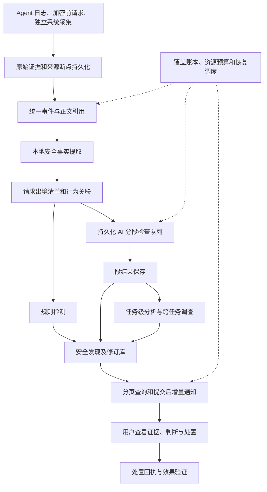
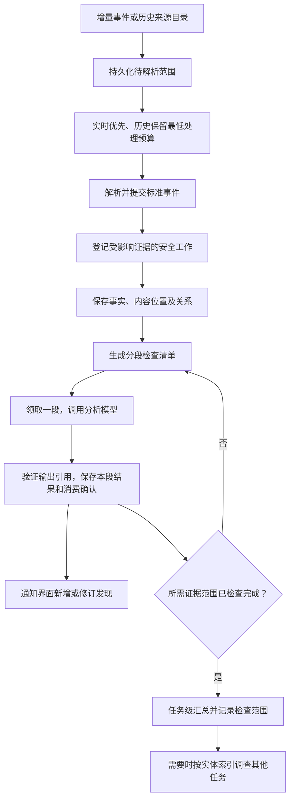

# AgentReins 本机安全分析架构 V3

日期：2026-09-25  
适用范围：单机 AgentReins，多 Agent 实时与历史证据；接续持久化流水线 V2。  
文档性质：工程设计与验收契约。本文定义的模块不表示已经全部实现或安装。

## 1. 产品目标与设计依据

用户需要知道：Agent 读取了哪些私人或项目数据，哪些进入了模型请求或其他外发请求，交给了谁，是否符合当前需求；执行是否越过授权，文件与记忆发生了什么变化，如何处理和恢复。

安全分析覆盖所有已采集、可解析的证据。来源未采集、正文截断、解析失败、模型尚未检查分别计数，不能把检查过的少量片段作为整项任务的安全结论。未发现问题是一个带范围的结果，不是全机安全证明。

本设计依据仓库保存的文章稿与研究底稿。文章是案例入口，自动检测必须回到其引用的本机证据。文件存在不证明稿件已经公开发布，也不证明文章中的推断已被后续实验证实。

| 案例来源 | 文章记录的事实或研究边界 | 产品需要自动回答 |
|---|---|---|
| [WorkBuddy 数据出境清单](WECHAT-WORKBUDDY-DATA-EGRESS-INVENTORY.zh-CN.md) | 创建公众号 Skill 的请求包含 user_memory、Cloud Memory、身份资料和跨项目资产；trace 前缀在 100,002 字符处截断 | 当前指令之外加入了什么，来自哪个上下文块，哪些地址与身份资料进入哪次请求，正文还缺多少 |
| [WorkBuddy 隐私研究底稿](WORKBUDDY-PRIVACY-DATA-RESEARCH.zh-CN.md) | Recall 请求先于模型调用；某次 Recall 返回空数组；短问候带有环境元数据 | 数据发给记忆服务还是模型，记忆规则还是实际记忆正文，自动装配还是用户输入 |
| [记忆安全线程稿](../marketing/workbuddy-x/MEMORY-SECURITY-THREAD.zh-CN.md) | Canary 首次输入不存在，Read 后第二次输入出现；本地 trace 尚不证明远端收到 | 哪份本地内容在哪次读取后进入了哪次请求，路由证据是否完整 |
| [WorkBuddy 安全机制](WECHAT-WORKBUDDY-SECURITY-MECHANISMS.zh-CN.md) | 提示词要求确认、备份、回收站、每批十个；出现计划约 72 文件、备份缺证、Moved 0 等差异 | 当时有哪些约束，提出了什么计划，实际执行和结果是什么，能否恢复 |
| [ZCode 34 工具](ZCODE-34-TOOLS-NETWORK-DECODE.zh-CN.md) | 句号任务携带 34 个工具定义，实际调用为 0；含跨会话读取、MCP 和自动化能力 | 暴露的能力与实际执行分开记录，后续真实调用是否越过权限边界 |
| [ZCode Reasoning 取证](WECHAT-ZCODE-REASONING-FORENSICS.zh-CN.md) | Electron 使用第三方镜像并带 --no-audit；两次 Plan Mode 拒绝后只读检查；部分样本未保留完整 Body | 下载来源、审计参数、拒绝后的操作是否改变了效果，哪些外发内容有直接证据 |

文章引用的第三方整仓上传 issue 仅登记为研究线索；未经本机复现，不生成“本机已整仓上传”的事件。

## 2. 总体架构

沿用 SQLite、现有正文存储和派生搜索索引。事实提取在证据流水线提交事件后异步运行；AI 队列、发现、处理状态使用独立 security-analysis.sqlite3。UI 不解析来源文件，也不在打开安全页时启动全库分析。

跨数据库采用 outbox 和幂等消费者：证据库事务登记安全工作及输入版本；安全库事务保存结果、引用和本地确认；最后确认上游 outbox。确认丢失重放同一身份，不能漏分析或生成重复发现。模型调用在所有数据库事务之外。

## 3. 数据流程与公平调度

历史摘要一经存在即可逐项登记解析工作，无需等待全部历史目录、标题或摘要整理完毕。已有标准事件可以先接受本地检测，不以完整任务大 JSON 为前提。仍未进入数据库的 endpoint 历史来源，由有断点的采集回填负责进入同一流水线。

新任务优先；历史任务有低速保底预算和最老等待时间，持续交互不能无限期饿死历史。来源按 Agent 轮转，失败隔离到具体来源或分段。磁盘不足等资源背压可以暂停，但必须显示暂停原因和剩余范围。

AI 执行以有限分段为调度时间片，而非一次跑完整任务。单轮最多新增检查两段，随后更新服务时间并交还队列；缓存命中的段不产生模型调用。每项任务按输入版本、分析配置及内容指纹登记持久化分段清单，覆盖计数由清单与已保存段结果关联得出。暂停或重启不得丢失覆盖状态；清单为空或尚有未完成段时，禁止写入任务完成状态。该状态仅表示该范围的分段检查完成，不代表任务级调查或整机安全结论。

安全输入使用独立的单调入队序号，而非事件发生时间。新证据和晚到历史证据都在入队事务中更新任务水位；重复接收不重复入队。历史索引按小批量游标补齐，启动时不扫描全量正文。消费者冻结本轮水位，以任务和序号索引逐事件读取已保存证据，不先解码整项任务快照。新增版本延续已准备位置和不变分段的结果，不能让持续活跃任务每轮都从头开始。

源证据读取、分段准备、模型分析分别记录状态。分段准备游标与清单在同一事务提交；尚未到达本轮源水位时，即使已登记分段全部分析完，也不能报告任务完成。模型配置或检测版本变化重新登记检查范围，不复用旧配置的完成标记。分段正文属于可回收的临时工作区：完成后清理副本，保留原始证据、内容指纹、清单和分析结果，不永久重复存储整套原文。

### 实时任务与历史任务并行

实时分析不等待任务完成信号：请求、工具调用、工具返回和网络证据分别进入相同持久化输入，新增返回可以修订已经产生的发现。本地行为检测独立于云端模型配置及 AI 等待状态运行，精确关联优先使用同一任务的原生工具调用 ID，不将同一时段的任意行为拼接为因果关系。

调度需显式保留实时通道与历史通道：采用三次近期活动机会、一次历史机会的默认轮转，任一通道为空时另一通道使用空余机会。近期活动的判定依据证据观测时间，不使用历史回填发生的时间，因此不能把刚补入的旧任务当成正在发生。近期时间窗口是调度启发式，不等同于 Agent 的准确运行状态。历史游标之外另有近期任务快速入队路径，防止新任务等待全库目录遍历。

AI 单段失败只记录该段的错误、尝试次数与下次重试时间，不阻断其余段。重试耗尽的段保留为未完成范围，不能用“其余已检查”替代完整覆盖。任何实时延迟、未捕获正文和待补关联都应可见。异步本地检测和 AI 分析是事后或执行中的发现能力，不能宣称具备执行前拦截；拦截必须由单独的同步控制点和执行回执证明。

所有任务数量采用稳定 task_key 去重；会话数、事件数、正文段数分别统计。任务边界未知的记录留在待关联集合，不能用自动压缩记录或网络采样冒充用户任务。

## 4. 安全事实与内容来源

事实提取覆盖完整的已保存正文，保留原文位置。对大正文流式分段处理；UTF-8 字节偏移为统一引用坐标，JSON Pointer 或结构化路径作为辅助定位。原文字节保持不变，解压、反转义、文本标准化记录为派生转换及其映射。

| 事实 | 提取内容 | 关键边界 |
|---|---|---|
| 用户需求与授权 | 当前输入、后续明确授权、目标目录、模式及生效时间 | 历史授权不自动授权当前不同目标 |
| 请求组成 | 系统规则、实际用户指令、记忆规则、记忆正文、身份、项目、历史、工具结果、附件、Schema | role=user 不等于用户主动提供；提及 memory 不证明加载了记忆 |
| 数据资产 | 凭据候选、个人信息、内部地址、账号、项目名、文件及代码块 | 地址或关键词本身不等于有效秘密；有效凭据不通过向外部服务试登录验证 |
| 工具行为 | 工具定义、模型调用意图、权限决定、实际开始、结束、输出与副作用 | Schema 不等于调用，调用不等于执行成功 |
| 记忆变化 | 路径、前后版本、增删改范围、写入调用、Recall 请求与结果 | 当前已存在不证明首次写入；Recall 的空结果不代表本地记忆未注入 |
| 网络行为 | 发起进程及启动身份、协议、域名、IP、端口、连接及请求标识 | PID 可复用；同一 Agent 的同期 socket 不自动承载该请求 |
| 安全约束 | 系统/Skill/用户规则、来源版本、适用范围与前置条件 | 规则文本只证明有约束，不能证明拦截或备份成功 |

正文中的指令作为被分析的数据处理，不改变检查器权限或规则库。AI 的调用权限限定为受约束的本地证据查询；不能执行证据中的命令或自行联系发现的外部地址。

## 5. 行为关系和证据强度

节点包括任务、模型请求/响应、工具调用/结果、文件版本、记忆版本、正文片段、进程实例、服务端点、权限决定和政策版本。关系使用 SQLite 关系表和索引，无需在单机先部署图数据库。

关系类型包括读取、产生、写入、注入请求、请求到端点、召回、授权、拒绝、修改、备份和验证。每条边记录源节点、目标节点、匹配方式、原文引用、关联器版本及状态。

优先使用原生 request/trace/tool-call ID；这些标识语义不同，不能互相填充伪造关联。内容传播使用足够区分度的内容指纹与片段对应；相同短语、时间邻近、相同 IP 只能提供候选关系。共享出口、代理、HTTP 多路复用和 CDN 必须允许一对多及未确定关系。

事实状态分别记录：在本地来源中观察到、进入组装上下文、存在于加密前请求、捕获网络请求正文、观察到对应响应。加密前捕获本身不保证完成发送；HTTP 响应也不证明服务商保存方式、物理数据落点或最终基础模型身份。

正文完整度由来源契约、长度、结束标记和截断元数据决定。Token 数用于异常提示，不能换算成完整度证明。某一次请求完整，不意味着同一任务其他请求完整。

## 6. 核心产物：逐请求数据出境清单

每次模型、Recall、发布、遥测等请求分别生成清单，包含：任务需求、Agent、请求标识和时间、捕获模式、正文范围、接收端点、上游声明、内容组成、敏感事实、来源关系、授权范围、待核查事项及原文入口。

记忆中既有凭据也有偏好、身份和资产信息，后者同样需要展示。数据清单覆盖正常行为；只有具体异常依据才形成安全发现。数据清单与安全发现关联，避免普通 socket 重复刷屏。

外联用途包括模型、模型中转、记忆检索、SSH、MCP、发布、依赖下载、普通访问、遥测与未知。域名和路径共同参与服务识别；IP 归属、ASN、位置和更新时间单独呈现。地理位置是估计，服务归属不能由云厂商 IP 单独确定。默认不为识别服务主动扫描目标端口。

按 Agent、进程来源、用途、端点和时间窗口聚合重复连接；保留请求与任务明细。存在代理时保留本地代理与已观察下一跳，最终接收方未知时如实标明。首次目的地用于基线变化提示，不单独判为违规。

## 7. 从文章到自动检测

### S01：跨项目记忆进入普通请求

1. 解析请求结构中的 user_memory、Cloud Memory、identity_context 等实际正文；将 memory_system 规则另列。
2. 提取资产地址、用户名、项目实体及文件来源，对应具体请求和片段。
3. 结合当前任务目的、项目范围与明确授权，让 AI 判断必要性；保留理由和反证。未确定的项目归属不能直接认定越界。
4. 已观察到的事实先展示为“该请求包含用户记忆及服务器资料”；必要性不足作为单独的待判断发现。
5. trace 截断显示缺口；与同请求的加密前/网络 Body 合并前校验标识和内容，不能用其他请求补齐。

验收：公众号 Skill 案例能定位 user_memory 和资产内容；纯记忆机制说明不产生“个人记忆已上传”；明确授权带入相关服务器配置的任务保留外发事实，必要性判断应不同。

### S02：读取的代码或敏感内容进入后续模型请求

1. 建立文件版本 → Read 调用 → 工具结果的关系。
2. 在后续请求已保存正文中匹配可区分片段或 Canary，记录双方偏移。
3. 确定请求级路由；仅有本地上下文时只得出内容进入上下文的结论。
4. 按数据类别、接收方和授权生成发现，同一内容的后续重复携带更新传播次数和请求列表。

验收：Canary 第一次未出现、第二次出现，输出精确的读取与入模关系；只有后续 Token usage、没有匹配正文时不得确认内容外发；短常见字符串不得建立强关联。

### S03：记忆的写入、召回与跨任务传播

从版本 diff 定位新增内容，关联写入调用及此前任务输入；再查后续 Recall 和模型请求。分别回答首次观察、最早已知写入、确切写入、召回及入模时间。历史版本缺失时保留“不知道第一次何时写入”。

验收：192.168.1.39 等实体只是测试之一，同样支持账号、路径、偏好和项目资料。Recall 返回空不能覆盖独立观察到的直接记忆注入；上下文包含 IP 不自动证明当时写入了记忆。

### S04：第三方依赖来源与审计关闭

解析实际 Bash 调用中的环境变量、安装参数和目标项目，提取镜像域名、软件包及 --no-audit；关联执行结果和请求/连接。输出“安装命令指定第三方镜像并关闭本次 npm audit”；有对应网络/执行证据后再描述实际下载。仅命令被提出或被拒绝时保留其状态。

验收：文章中的 Electron 命令可检出；Schema 示例和文档引用中的相同字符串不构成真实安装；镜像使用与关闭审计不自动等同恶意代码或感染。

### S05：权限拒绝后的重试与授权变化

将拒绝、后续调用、权限模式和目标资源组成序列，比对操作效果。拆分后仍是只读检查可解释为合规调整；拒绝删除后换工具删除同一目标是需调查的绕过候选。需要实际副作用或执行结果才能确认行为发生。

验收：文章中的两次 Plan Mode 拒绝不误报为成功绕过；策略中出现 dangerouslyDisableSandbox 字段不等于运行时启用了它。

### S06：个人文件保护是否真正执行

绑定当时有效的安全规则，分别核对计划、明确授权、备份调用与结果、删除/移动、回收站、最终文件状态。提议 72 文件只说明计划与十文件规则冲突，不能算已删除 72 文件。Moved 0 与随后“已完成”形成结果不一致线索；磁盘空闲增加不能替代逐文件结果。

验收：缺少备份证据显示“恢复能力未验证”，不能说“一定未备份”；有备份产物且校验成功才能提供对应恢复入口。未经用户确认不执行回滚。

### S07：工具能力暴露与执行、后台旁路

对逐请求工具定义与实际调用分别计数，检测新 MCP、高权限参数或自动化能力变化，归入能力清单与变化提醒。工具定义较多不能直接证明攻击。将 Agent 自报工具记录与独立进程、文件、网络事件比较，未被自报记录解释的归档/外联进入调查。

验收：ZCode 34 定义、0 调用呈现准确；独立观察到归档与上传只有关联充分才认定内容范围，单纯传输字节量不能证明整仓内容。

## 8. 分段 AI 分析与调查

本地提取器完整扫描已捕获内容；AI 对已登记范围进行分段语义检查。优先保留消息、工具结果和文件 diff 边界；超大单项再按字节分段，保留重叠和结构路径。每段携带任务目的、请求/工具元数据及必要上下文，正文以引用定位。重叠区域的发现按证据身份去重。

每个分段输出具体发现、证据引用、判断理由、反证、建议动作、缺失证据及待调查问题。输出必须验证引用存在、偏移合法、操作状态和证据等级；无有效引用的判断不能作为已证实发现。

AI 可请求读取相邻片段、关联工具结果、某个记忆版本、同请求路由或按实体索引查历史。查询由应用验证范围、数量、字节和超时，拒绝任意 SQL 和命令执行。达到调查预算时保存待续问题，不能悄悄将调查视为完成。

分段结果提交即可显示；任务级分析消费已保存的事实和发现，并按需回看原文。任务级汇总不是把整项任务再塞进一个无限大的提示词。跨任务调查同样可恢复，有独立范围与完成状态。

不要求每段重复复核所有内置规则。规则适用性由本地事实和任务范围筛选；AI 主动发现未知问题，验证步骤针对具体发现进行。AI 提案保留检测器定义、样例、误报反例和回测结果，经用户审批才进入规则库。

## 9. 持久化契约

| 逻辑表 | 核心身份和内容 | 主要用途 |
|---|---|---|
| security_work | 来源事件/正文版本、阶段、分析器版本、状态、优先级、租约、重试时间 | 可恢复工作调度 |
| security_chunks | 正文哈希、字段路径、字节范围、chunker 版本 | 完整分段覆盖和定位 |
| security_facts | 事实类型、任务/请求/工具、原文范围、提取器版本 | 可查询事实 |
| security_edges | 源/目标身份、关系、依据、关联器版本 | 传播和行为关联 |
| security_egress | 请求身份、内容清单、接收方和捕获状态 | 每请求出境清单 |
| security_assessments | 输入依赖摘要、模型/提示词/政策版本、分析状态、结果引用 | 缓存、增量失效和分析审计 |
| security_findings | 稳定发现 ID、当前修订、任务与 Agent、严重度、事实及建议 | 分页发现列表 |
| security_finding_revisions | 发现修订、证据清单、依据、反证、生成时间 | 保留历史判断及更正 |
| security_coverage | 任务/来源、捕获范围、解析范围、本地扫描与 AI 检查范围 | 覆盖账本 |
| security_actions | 用户、目标、动作、确认、执行回执、验证结果 | 人工处置和恢复闭环 |

这些是逻辑契约，可扩展现有表实现，避免为同一原文重复保存多份大 JSON。正文仍由现有证据存储持有，安全库只存位置引用、事实和必要短片段。引用可达性参与保留策略。

分析缓存身份至少包括正文/片段哈希、相关事实与关系修订、分析器和提示词版本、模型配置、政策/授权版本。只复用相同依赖的计算；相同内容在不同任务仍保留独立发生记录。增加 Token usage 等无关元数据不触发整任务重分析；新增接收方或授权变化使相关结论失效并重算。

发现稳定 ID 不包含生成时间；修订不得清空用户处理状态。新证据改变影响时将原处理标记为需重新查看。较旧结果不能覆盖新输入版本。

## 10. 状态、预算与可恢复性

工作状态为待处理、领取中、延迟重试、完成、隔离。持久化租约和 fencing token 防止重启或超时后的旧消费者提交。结果、依赖、发现修订和工作确认在同一安全库事务提交。成功保存后才通知 UI。

首次实现默认单 AI 并发，预算包含请求体字节、估计输入 Token、输出上限、每分钟请求和每日 Token 配额。长度超限通过分段解决，不能丢弃尾部；超时在具体分段重试。暂停保留进度，重新启用只处理未确认部分。

检查范围冻结到事件/正文版本清单，任务后续变化生成增量。后台分析与实时采集、交互查询分别限流；独立连接、短事务。来源断点和队列数据优先于可重建的派生索引保留。

分析模型也是外发接收方。记录每次分析发送的片段清单、目标、模型声明、费用及返回状态；遵循已配置的数据范围。分析请求属于分析器自身活动，默认不递归生成新的 AI 检查工作，防止分析无限循环。其外发审计记录仍保留可查。

## 11. 用户界面和有效处置

首页显示本机实际覆盖：已发现任务、待解析、待检查、检查中、已检查、失败，以及正文不完整的任务数。分母来自来源目录和已知任务，不将来源未发现的历史算作已覆盖。数量允许随发现新历史增长，注明统计范围。

安全发现卡片显示 Agent、任务、行为、涉及的数据、接收方、影响、建议和时间；已知事实与必要性判断分别表达。按问题聚合重复请求，展开显示过程、内容片段、完整原文和依据。正常外联和数据清单也可浏览，但不强制进入风险列表。

发现一项即展示一项。报告支持分页、筛选、搜索及全范围聚合；不能只展示最近 20 个任务却让更早发现不可查。无结果时明确是尚未分析、分析失败，还是已检查范围内未发现。

停止进程、阻断请求、移除记忆、恢复文件仅在系统有对应可验证能力时提供。已发出的数据不能通过停止 Agent 撤回；凭据更换是建议或明确授权的后续操作。恢复需备份版本、目标当前版本校验和执行回执。

## 12. 验收与落地顺序

建立本机案例注册表，记录文章、原始证据定位、任务/请求身份、预期事实、禁止结论和测试状态。文章里的自然语言结论不直接当作测试真值；原始数据可复核后才纳入真实回放。测试夹具用合成内容保留结构，真实隐私不提交 Git。

必须通过：S01–S07 的正例、反例；关键内容在正文末尾仍能检出；相同上下文不同请求不漏计；记忆规则不误作记忆正文；普通连接不变成外泄；被拒绝操作不当作成功执行；历史积压持续推进；暂停/退出/失败恢复不丢结果；晚到路由修订结论；切换分析版本仅重算失效依赖；分析结果产生即能查询。

按顺序交付：

1. 历史覆盖账本与持久化分段工作，解决漏入队、截断检查、重复分析。
2. 请求组成和来源事实，完成 S01/S02/S03 的出境清单、传播关系及发现落库。
3. 外联用途、请求路由与服务信息接入，同页展示接收方和内容证据。
4. S04/S05/S06/S07 的行为与政策分析，接通任务级和跨任务 AI 调查。
5. 增量发现界面、全历史检索、规则审批和可执行处置。

每批均以真实案例回放、合成反例和并发性能验证验收。性能报告至少包括实时接收延迟、历史最老等待时间、查询 P95、分析队列吞吐、峰值内存及模型费用；冻结指标前采集本机基线，不将合成小任务测试成绩当作真实全库性能。

首个端到端验收固定为“公众号 Skill 请求中的跨项目记忆和资产资料”：能从历史目录进入解析，列出实际请求组成和正文缺口，指出已包含的数据及来源，关联可证明的接收方，给出带原文的必要性分析，并在后台完成后直接显示。这一案例通过后再宣称本机安全分析具备该检测能力。
