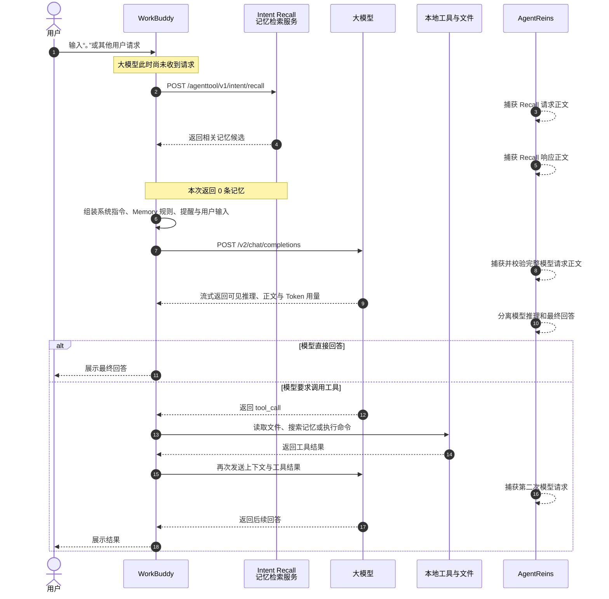

# 当你只输入一个句号，WorkBuddy 实际向大模型发送了什么

> 一次由 AgentReins 完整网络正文采集还原的 Agent 上下文装配过程

很多人以为，在 AI 编程 Agent 中输入一句话，发生的事情就是：

```text
用户问题 -> 大模型回答
```

真实过程复杂得多。2026 年 9 月 21 日，我们让用户在 WorkBuddy 中发送一条明确禁止读取文件、项目和记忆的基线请求，并关闭全部工具。AgentReins 在本机捕获了 WorkBuddy 发出的完整 HTTPS 请求与响应正文。

结果显示：大模型看到的并不只是用户输入。WorkBuddy 在模型收到问题之前，已经主动进行记忆检索，并组装了系统指令、Memory 规则、系统提醒和用户问题。

本文只展示经过脱敏的结构和必要短片段，不公开用户路径、身份信息、凭据或第三方系统提示词全文。

## 一、完整会话流程



最重要的时间关系是：`intent/recall` 发生在第一次 `chat/completions` 之前。因此首次记忆检索不可能是大模型要求的，它由 WorkBuddy 运行时主动触发。

## 二、这次实验如何进行

为了区分“Agent 主动发送”和“模型要求读取”，基线请求采用了以下约束：

- 用户明确要求不要读取文件、项目或记忆。
- WorkBuddy CLI 的工具列表为空。
- 最大 Agent Turn 数为 1。
- 不保存本次测试 Session。
- 所有流量只通过本机 `127.0.0.1` 审计代理转发。
- AgentReins 不修改系统代理，也不修改系统信任库。

模型最终返回了预期文本，期间没有工具调用。因此这次实验观察到的记忆相关内容均发生在模型调用之前，不能归因于模型的工具决策。

## 三、模型请求之前还有一次记忆检索

WorkBuddy 首先访问：

```http
POST https://copilot.tencent.com/agenttool/v1/intent/recall
Content-Type: application/json
```

请求结构非常简单：

```json
{
  "query": "[WorkBuddy 组装后的检索文本，已脱敏]"
}
```

本次实测：

| 项目 | 观察值 |
|---|---:|
| `query` 字符数 | 13,615 |
| Recall 返回码 | 0 |
| 返回记忆条数 | 0 |
| 是否早于模型请求 | 是，约早 10 秒 |

这意味着，即使用户只输入很短的内容，WorkBuddy 也可能先把一段远长于用户输入的文本发送给记忆检索服务。

Recall 响应结构为：

```json
{
  "code": 0,
  "msg": "[状态说明]",
  "requestId": "[请求标识]",
  "data": {
    "results": []
  }
}
```

本次没有检索出历史记忆。若 `results` 非空，还需要继续验证每条结果是否被 WorkBuddy 放入随后的模型请求，不能仅根据 Recall 成功就声称数据已发送给大模型。

## 四、真正发送给大模型的 JSON

随后 WorkBuddy 请求：

```http
POST https://copilot.tencent.com/v2/chat/completions
Content-Encoding: gzip
```

请求顶层字段如下：

```json
{
  "model": "auto",
  "messages": [],
  "temperature": 0,
  "max_tokens": 0,
  "stream": true,
  "stream_options": {},
  "reasoning_effort": "[级别]",
  "verbosity": "[级别]",
  "reasoning_summary": "[配置]"
}
```

上面的数值使用结构占位，不代表真实配置值。真正重要的是 `messages`。

本次请求只有两个 Message：

```json
{
  "messages": [
    {
      "role": "system",
      "content": "[WorkBuddy 系统指令，15,693 字符]"
    },
    {
      "role": "user",
      "content": [
        {
          "type": "text",
          "text": "[Memory 规则与结构，13,313 字符]"
        },
        {
          "type": "text",
          "text": "[系统提醒，470 字符]"
        },
        {
          "type": "text",
          "text": "<user_query>[用户真正输入]</user_query>"
        }
      ]
    }
  ]
}
```

这揭示了一个容易误解的事实：HTTP JSON 中的 `role: "user"` 不等于“全部内容都由用户输入”。WorkBuddy 将自身注入的 Memory 规则和系统提醒也放进了 `user` Message。审计产品如果只按 OpenAI Role 分类，就会把 Agent 注入内容错误标记为用户数据。

## 五、各段上下文到底是什么

### 1. System Message

本次约 15,693 字符，描述 Agent 的行为方式、工具规则、任务执行约束和输出要求。它由 WorkBuddy 提供，不是用户输入，也不是模型临时要求。

文章不复述第三方系统提示词全文。安全审计应保留原始证据，但公开报告只需要展示结构、来源、哈希和必要短片段。

### 2. Memory 规则块

第一段 User Content 约 13,313 字符，采用 XML 风格结构，包含类似下面的层次：

```xml
<memory>
  <types>
    <type>
      <name>[记忆类型]</name>
      <description>[用途说明]</description>
      <when_to_save>[何时保存]</when_to_save>
      <how_to_use>[如何使用]</how_to_use>
      <examples>[示例]</examples>
    </type>
  </types>
  <search>[检索规则]</search>
</memory>
```

本次块中存在绝对路径形式的内容，但 Recall 返回 0 条结果。根据现有证据，我们可以确认“Memory 机制说明和路径信息被发送”，不能声称“历史记忆正文已发送”。

### 3. System Reminder

第二段 User Content 约 470 字符，使用：

```xml
<system-reminder>
  [运行时提醒]
</system-reminder>
```

它在协议角色上属于 `user`，但来源仍然是 WorkBuddy。AgentReins 必须根据内部标签和证据来源重新分类，而不是照搬 Role 名称。

### 4. 用户真正输入

第三段只有 71 字符，使用：

```xml
<user_query>
  [用户真正输入的内容]
</user_query>
```

也就是说，用户界面中的一句话只是整个模型输入的一小部分。

### 5. 项目和历史数据

本次基线模型请求没有检测到 `project_context`、项目布局或工具返回结果，也没有检索到历史记忆。因此本次实验不能证明历史项目正文被发送。

但如果未来请求出现以下来源，就需要分别标注：

| 内容 | 可能来源 | 谁触发 |
|---|---|---|
| 首次请求里的项目摘要 | WorkBuddy 启动时自动装配 | Agent 主动 |
| Recall 返回的历史记忆 | WorkBuddy 请求 Recall | Agent 主动检索 |
| 模型 `tool_call` 要求读取文件 | 模型响应 | 模型明确要求 |
| 工具执行结果进入下一次请求 | WorkBuddy 执行并回传 | 模型触发，Agent 实施 |
| 用户直接粘贴的代码或文件 | 用户输入 | 用户主动提供 |

## 六、网络大小和 Token 数据

本次 `chat/completions` 请求的完整性证据：

| 项目 | 观察值 |
|---|---:|
| gzip 线上正文 | 11,945 字节 |
| HTTP 声明长度 | 11,945 字节 |
| 解压后的 JSON | 30,358 字节 |
| SHA-256 | `d59476f8...069050` |
| HTTP 状态 | 200 |
| 输入 Token | 6,259 |
| 输出 Token | 418 |
| 推理 Token | 412 |
| 命中缓存 Token | 512 |

声明长度与捕获长度一致，JSON 可以完整解析，响应边界完整，因此这次请求可以标记为“完整正文已捕获”。Token 只是辅助指标，不能替代正文，也不能用于反推出未捕获内容。

## 七、大模型如何返回结果

WorkBuddy 使用流式响应。每一行是一个 SSE `data:` 事件：

```text
data: {
  "model": "hy4-preview",
  "choices": [{
    "delta": {
      "role": "assistant",
      "reasoning_content": "[可见推理片段]",
      "content": "[回答片段]",
      "tool_calls": []
    }
  }],
  "usage": null
}
```

流结束前的事件提供 Token 用量。AgentReins 将两个方向分开：

- `Agent -> 模型`：发送的上下文、记忆、项目内容和工具结果。
- `模型 -> Agent`：模型返回的可见推理、工具调用决定和最终回答。

模型服务端从未返回的隐藏推理不在采集范围内，也不能被声称为已捕获。

## 八、谁决定发送数据

判断责任不能只看最终请求里有没有某段数据，必须看时间顺序和触发证据。

### Agent 主动发送

满足以下条件时，可以归类为 Agent 或运行时主动发送：

1. 数据在第一次模型请求中已经出现。
2. 在此之前没有模型响应或 `tool_call`。
3. 内容来自 Agent 的系统模板、自动 Recall、工作区扫描或默认上下文装配。

本次 Memory Recall 和 Memory 规则块属于这一类。

### 模型明确要求

需要看到完整因果链：

```text
模型响应中的 tool_call
  -> WorkBuddy 执行对应工具
  -> 工具读取具体数据
  -> 下一次模型请求包含该工具结果
```

缺少 `tool_call` 时，不能把 Agent 自动上传的数据归因于模型。

### 暂时无法判断

如果只有最终请求正文，没有前序响应、工具事件或本地 Session 关联，就只能说“观察到该数据被发送”，不能确定是谁触发。

## 九、普通日志为什么回答不了这个问题

Token 日志只能说明大概发送了多少内容，Socket 日志只能证明连接过哪个地址。本地 Agent 日志可能截断正文，也可能把系统注入和用户输入混在一起。

要回答“到底发送了什么、是谁要求的”，至少需要同时具备：

1. 完整请求正文。
2. 完整响应和工具调用。
3. 请求的先后顺序。
4. Session、Turn 与本地工具事件关联。
5. 请求长度、哈希和协议边界校验。
6. 对系统注入、用户输入、记忆和项目数据重新分类。

这也是 AgentReins 数据出境清单的目标：数字用于证明完整性，正文用于让人理解发生了什么，因果链用于判断责任。

## 十、这次实验能够证明什么

可以证明：

- WorkBuddy 在模型请求之前主动调用了记忆检索接口。
- Recall Query 远长于用户真正输入。
- 本次 Recall 返回 0 条历史记忆。
- 模型请求包含约 1.57 万字符系统指令。
- `role: user` 中还包含约 1.33 万字符 Memory 规则和约 470 字符系统提醒。
- 用户真正输入只占最后一个短文本段。
- 模型没有要求读取文件或记忆，因为本次没有工具调用。

不能证明：

- WorkBuddy 每一次请求都会发送完全相同的上下文。
- Recall 返回的记忆一定会发送给大模型。
- 本次发送了历史项目正文。
- 服务端没有保存收到的数据。
- 能够读取服务端从未返回的隐藏推理。

## 结语

用户看到的是一个输入框，大模型看到的却可能是一整套由 Agent 运行时拼装的环境。真正值得审计的不是 Token 数，而是每一段内容是什么、从哪里来、由谁触发、发往哪里，以及证据是否完整。

当我们能够把这条链路完整还原后，“Agent 有没有主动上传用户记忆和项目数据”才从猜测变成一个可以逐请求验证的问题。
