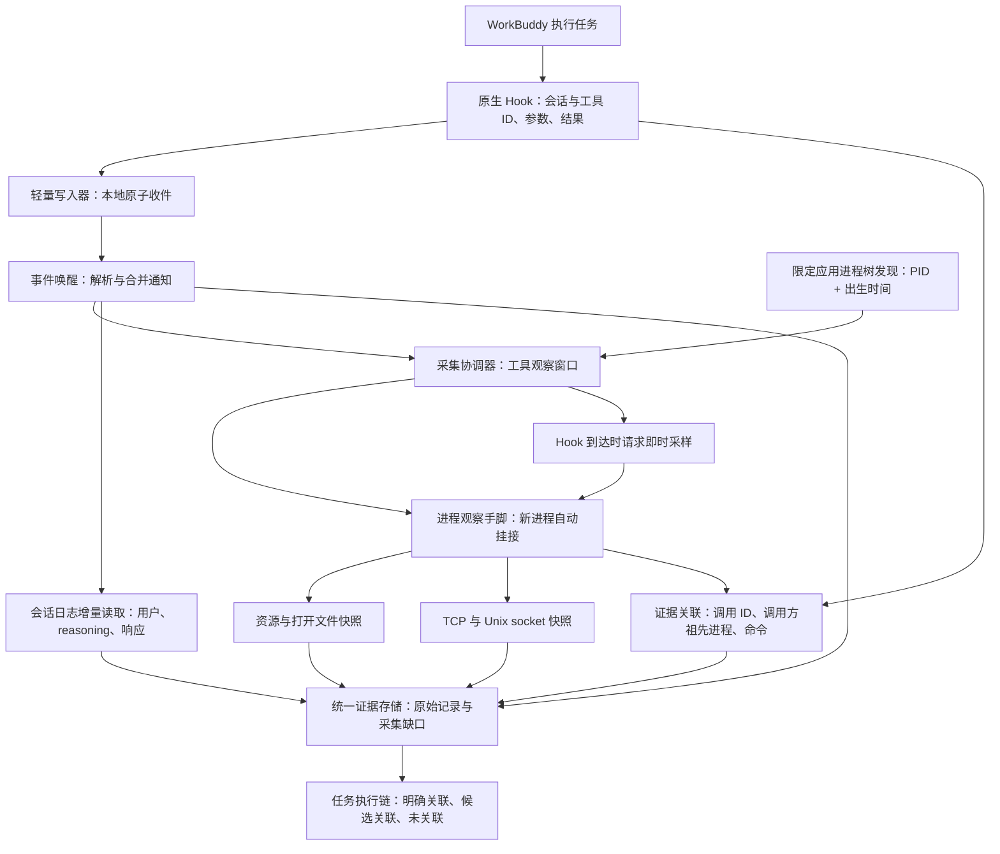
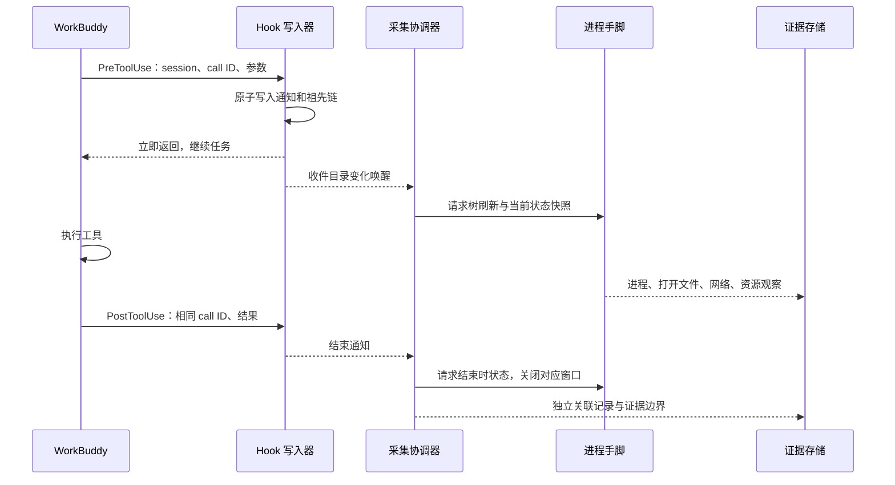

# AgentReins V4：Hook 与进程观察协同采集

范围：macOS、原 AgentReins、WorkBuddy；采集与关联，不阻断，不引入ESF/全机高频扫描/外部消息队列。

## 协同原则

1. Hook只通知动作，不等待采样完成；它是异步观察，不是阻断屏障。开始通知到达时的快照可能已经晚于工具启动，明确标为“收到通知时采样”，不得称为执行前快照。
2. 轻量Hook写入器补充自身和祖先进程的PID、出生时间、可执行路径，限定祖先链、不读环境或全机参数。父进程链描述谁调用Hook，不代表谁执行工具。
3. Hook解码后立刻发送协调信号，不等待数据库持久化锁。原始事件仍独立入库，成功后确认收件。
4. PreToolUse打开按session_id+tool_call_id隔离的观察窗口，PostToolUse关闭对应窗口；工具调用ID缺失时保留通知但不猜一个工具窗口。短时间保留已结束窗口，以接受晚到的进程证据。
5. 协调器发起限定应用树刷新、资源/文件快照、定向网络/IPC采样；已有采样进行时合并待处理请求，避免每次Hook启动一个重扫描任务。
6. 进程发现继续独立工作，新子进程仍按PID+出生时间挂接观察手脚；即使没有Hook也保留行为证据。
7. 关联层使用原始进程观察的命令、父子链与开始/结束时间，输出单独的关联记录，不改写原始样本。
8. 仅时间接近不足以归属。调用方进程分支明确，且工具命令/执行进程命令有可核对的一致性时，也标为推断；没有直接执行PID证据不得标成确认执行。多个相同并行命令均保留候选，禁止强选一个。
9. 生命周期短于进程发现间隔仍可能漏。Hook能证明调用与返回，但不能补造缺失的文件系统调用、短连接正文或内存内容。

## 工具调用时序

## 状态与保留

- 窗口按会话和调用ID隔离，支持嵌套/并行工具；Stop只能结束本会话的残留窗口。
- 缓存与待采样队列有数量及时间上限；不得无限增长，不运行每PID工作进程。
- 所有PID与出生时间共同验证，排除复用PID；关联失败不丢弃原始行为。
- 上一轮状态不是执行前同步屏障；文件“打开”不是证明读取全文，socket“连接”不是证明发送了具体内容。

## 本次实现验收

- Hook信号确实触发进程侧采样请求，且不等待证据数据库写入完成。
- 并行调用、不同会话、PID复用、通知与进程事件乱序均不串证据。
- 有分支与命令依据才输出候选/推断关联；纯时间重合、不匹配的命令、缺失调用ID不强行关联。
- 既有无Hook的进程采集仍运行；最终保存原始数据及独立关联记录。

## 本次实现结果

- Hook写入器记录最多8级祖先的PID、父PID、出生时间、可执行路径；不采集全机参数或环境。
- WorkBuddySight.onHookSignals 在解码后发送控制通知，独立于后续数据库事务；原始Hook仍通过既有事务入库。
- ProcessGuard 合并并限量保留采样请求，刷新进程树后请求资源/打开文件及网络/IPC快照。样本携带触发Hook ID并说明非同步执行前屏障。
- 已知调用方分支优先，保留并行活跃分支；身份缺失退回WorkBuddy范围，绝不据此确认执行进程。
- HookProcessCorrelation 维护按会话与调用ID隔离的有限窗口与进程历史，支持结束通知先到的乱序情况；输出 hook_process_candidate 独立关系，保留原始进程样本不改写。
- 关联使用命令文本、调用方分支和PID出生身份共同约束；纯时间重合不输出关系。多个相同并行命令保持 ambiguous/unknown。
- 有限状态：128个窗口、512个进程历史、512条通知去重、资源与网络各32个合并触发。关闭窗口保留30秒用于晚到证据；未关闭窗口最长30分钟。
- 17项测试通过：调用方分支、命令匹配、时间单独不足、PID复用、乱序结束通知、并行同命令、Hook触发保留未变化样本、Hook及日志实时入库、reasoning与socket既有功能。

应用已重新打包、通过签名验证并加载；打包Hook已验证祖先记录含PID出生身份、最多8级。

待真实任务验收：更新后的WorkBuddy新会话是否提供工具参数与调用ID、Hook祖先是否与进程树一致，以及短命执行进程的实际漏采率。单元/集成测试通过不代表真实任务已全覆盖。

## 2026-10-04 真实任务后的补充修复

- 停用 WorkBuddy 与 Claude Code 的 LoongSuite Hook，各 5 项，保留原设置备份。锁文件 PID 17760 已退出，未发现其 LaunchAgent。
- Native Hook 内直接取得调用方及其子进程资源快照，最多 32 个进程、循环时间预算 15 ms。快照单独标为调用方分支观察，不能当作工具执行器证据；退出早于 Hook 的进程仍无法恢复。
- 无 shell 命令的 WebSearch 也有 hook_caller_observation，记录真实发出 Hook 的 WorkBuddy PID、出生身份及原始调用 ID。关系是 Hook 调用方，不是搜索执行器。
- Hook 触发的采样包含验证过的 WorkBuddy 祖先，补足 SDK 上层后端的网络观察；正在采样期间收到的通知，会在完成后立即继续处理。
- Hook 输入上限从 1 MiB 提升至 16 MiB，超限或非法输入生成 CaptureGap，明确正文未保留、会话未知；不会假装采集成功。
- Hook 使用 release 优化构建。WorkBuddy Electron 隔离测试进程下，首次启动 1288 ms，后续 17–19 ms；能观察到测试用 sleep 子进程。此为隔离测试，不代表真实工具短进程召回率。
- 网络文件回放有界、避免轮询重入；每次最多读取 8 MiB 批次，单条超大记录放宽至 64 MiB，不在启动时一次加载全部历史文件。
- 修正“用户文本相同 + 时间窗口”被标为 confirmed 的错误；改为 inferred。没有原生关联键仍不确认网络请求属于哪个会话。
- 新启动入口 scripts/launch_workbuddy_capture.py 同时设置 WorkBuddy 自身 http.proxy 和应用代理变量到 18891，使用已有审计 CA，保留设置备份，不修改系统代理或系统证书库。
- 清理旧 /Applications/AgentReins.app 的孤立代理 PID 37088，修复 18891 端口冲突；新代理 PID 31659。
- WorkBuddy 新主进程 32278、后端 32327、预热进程 32371 的 HTTPS_PROXY 均为 18891。独立路由日志已收到真实启动请求及 200 响应。

待新任务验收：模型完整请求/响应正文是否进入独立采集器、正文中工具调用 ID 能否与原生调用精确对应、短进程实际漏采率。启动流量通过不等于所有任务上下文已经采全；不声称已实现内存正文、文件系统调用或全覆盖短连接采集。
