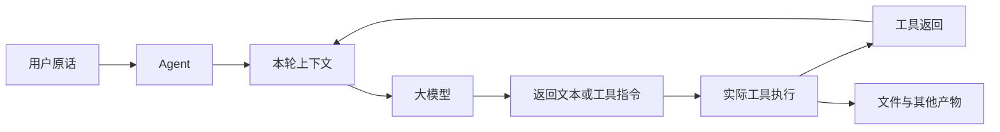
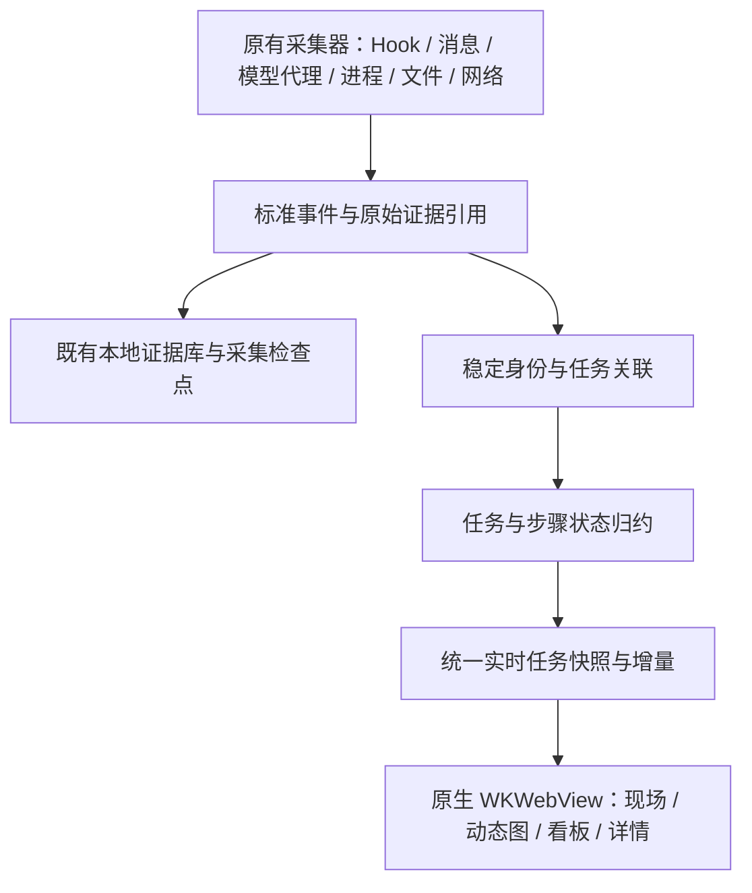

# AgentReins 实时生命周期可视化设计书

版本：1.0 · 2026-10-09 · 状态：实施设计，不能作为已完成说明

配套：[全生命周期详细设计](LIFECYCLE-DETAILED-DESIGN.zh-CN.md)，逐环节定义默认展示、点击详情、采集关联与完成条件。

## 1. 做成什么产品

AgentReins 是独立运行的 Agent 实时工作台。用户在 WorkBuddy 或 Codex 发出任务后，能找到这条原话，看到任务当前走到哪一步，理解 Agent 与模型交换了什么、模型要求执行什么、实际执行了什么，最后打开结果验证。

产品围绕三个问题组织：现在是否在推进；方向是否正确；结果在哪里。采集现场、任务动态图、结果看板是同一个任务数据模型的三个视图，不是三个各自拼接日志的页面。

保留已有进程、文件、网络、IPC、原生 Hook、模型正文及证据持久化技术。当前范围只做 WorkBuddy、Codex 的实时运行；不做 SessionLens 集成、旧任务检索、历史分析和历史回放。现有视觉参考沿用用户给出的清晰任务卡片和分栏布局；动态图用于解释过程，不用它取代原话、状态和交付物。

**完成标准：用户不看日志、不懂调用编号，也能找到自己刚发的任务，知道当前动作，点开看到实际内容，再打开产物。**

## 2. 用户操作与页面

### 2.1 统一任务入口

左侧显示 WorkBuddy/Codex 及当前任务列表。任务卡片第一行是需求原话的短标题，第二行是明确状态与当前步骤，第三行是最近活动时间。标题可截短，需求正文必须保留完整已采文本。多任务并行不互相覆盖。

新输入自动出现；用户主动选中任务或点开详情后，固定阅读对象，新任务以数量提示出现，不能抢走页面。搜索限本次实时运行，支持原话、工具名、文件路径。Agent 连接正常不等于该任务采集完整。

### 2.2 采集现场：确认看到了什么

以采集源卡片展示进程、文件、网络、Hook、会话消息、模型正文：最近成功时间、收到数量、采集延迟、异常原因。提供明确采集覆盖矩阵，例如“用户原话已采 / 模型正文缺失 / 工具返回已采”。

下方保留完整应用进程树、执行资源、文件及网络/IPC观察与原始记录入口。没有任务归属的记录进入“尚未关联”，不能消失，也不能硬归最新任务。过滤后的条数、总条数、缓存截断分别标明。

### 2.3 任务过程：默认动态图，点击看实际内容

页面顶部始终显示：用户原话、任务状态、当前动作、最近进展及已观测用量。原话是独立内容区域，不能藏在证据编号下面。

主图按生命周期排列：

实际界面以 Agent 为中心展开成蜘蛛关系图；按模型轮次折叠，当前步骤展开。命令、Skill、MCP、文件、网站分别用文字和图标区分，颜色仅辅助状态。并行调用分支并排出现，重试保留前次失败，不覆盖成一次成功。

只显示有证据的节点。工具指令与实际调用分开：模型说“执行命令”只能生成指令节点，收到执行开始记录后才显示执行中。进程和网络独立观察放在侧边，用“观察到 / 归属待核对”关系，不能冒充执行链。

收到新事件才播放一次沿线动画；不持续转圈制造忙碌感。当前步骤显示“正在读取 xxx”“等待模型响应”“等待你确认”，不能只写“进行中”。长期无新记录显示最后活动时间和“暂未观察到新进展”，不能直接判定卡死。

点击内容规则：

| 点击对象 | 右侧首先展示 | 次级信息 |
| --- | --- | --- |
| 用户原话 | 原文、附件引用 | 来源与接收时间 |
| 本轮上下文 | 本次实际发送的消息组成、内容、相比前次增减 | 完整性、模型、请求证据 |
| 模型 | 实际返回文本、工具指令与参数 | 已采用量、响应配对依据 |
| 命令/工具 | 工具名、实际参数、执行状态、已采输出 | 开始结束时间、退出码、执行器关联 |
| Skill | 已证实的调用或说明文件加载 | 文件路径；只读取说明不等于已调用 |
| MCP | 服务、方法、参数与返回 | 调用标识、服务进程关联 |
| 文件 | 路径、已采内容或 diff、读取/写入依据 | 原始文件观察；打开句柄不等于读到全文 |
| 网站/网络 | 实际 URL 或已知地址、请求/返回覆盖 | 域名推断依据；连接不等于访问完整页面 |
| 连线 | 这一步实际传递的内容 | 两端标识与关联依据 |
| 产物 | 文件名、类型、存在状态、预览/打开 | 生成步骤、变更范围、验证结果 |

来源、会话、调用编号进入“技术详情”折叠区，不挤占内容。用户原话面板没有“工具输出”模板。阅读时固定详情快照，并提示有新版本可切换；不静默替换正在看的内容。

### 2.4 结果看板：结果必须能打开

四列为“进行中”“等我确认”“已完成未读”“失败”。开始前任务可在进行中列标记“待开始”。阅读后移至当前运行的已读区；采集缺口是独立提示，不能和任务失败混成一类。

任务卡展示原话短标题、当前步骤或结果摘要、耗时、已采用量、产物入口。打开卡片进入同一任务的过程与产物面板，不进入另一套证据页面。

开发产物展示本轮实际变更文件和 diff；办公产物展示文件与可用预览。已有文件只被读取不能自动称为新交付物。Agent 声称“完成”与产物存在、可打开、已验证分开显示。没有产物的问答任务以实际最终回答为结果。

## 3. 状态怎样判断

任务状态、步骤状态、采集健康是三个维度，分别维护。

| 任务状态 | 允许的依据 | 不允许的推断 |
| --- | --- | --- |
| 待开始 | 已收用户原话，尚无开始记录 | 有进程就算开始 |
| 进行中 | 原生任务开始、模型请求、工具开始等 | 动画还在播放 |
| 等我确认 | 明确授权/输入请求尚未解除 | 长时间没返回 |
| 已完成未读 | 原生任务结束或明确最终答复；该结果未读 | 某个工具成功返回 |
| 失败 | 原生任务失败或明确终止错误 | 单个工具失败后仍在重试 |
| 已取消 | 原生取消/中止确认 | 用户点了取消按钮但未获确认 |
| 状态待确认 | 缺少足够生命周期证据 | 为填满看板强行分类 |

步骤状态为计划、已请求、执行中、等待授权、返回成功、返回失败、取消、返回未观测。任务结束不能自动把所有未返回工具标为成功。

采集健康为正常、降级、断开，独立标注缺失项。等待时间只能触发“无新进展”提示；发现额度数据缺失则不显示虚构的零成本。累计 tokens/费用按原生请求去重，不重复累加流式片段；无计价依据不推算金额。

## 4. 技术架构与继承方式

现有 Swift/macOS 原生宿主、WKWebView、本地 JS/SVG继续使用，不引入另一个展示服务作为生产入口。18952 的原型页面只作设计验证；生产必须有单一、明确的实时数据入口及版本标识。

| 现有模块 | 继续承担的职责 | 需补强的契约 |
| --- | --- | --- |
| ProcessGuard / 进程观察协调器 | 进程树、资源、打开文件、TCP/Unix IPC，Hook触发采样 | PID与出生身份；关联依据与观察缺口 |
| FileGuard / 工具行为投影 | 文件变化与工具文件意图 | 读取意图、系统观察、实际内容分开 |
| WorkBuddySight / 原生Hook | 用户输入、工具开始结束、原生身份 | 缺turn保留会话活动；输入优先完整采集 |
| WorkBuddyNetworkCapture / 现有代理 | 模型请求响应正文、流式工具指令 | flow标识、请求配对、正文覆盖与代理存活 |
| CodexSight | 原生rollout兼容解析 | 稳定session/turn/call、增量上下文、结束事件 |
| EvidenceDatabase | 原始证据、检查点、健康 | 写入失败可见；提供当前任务证据定位 |
| 实时状态与投影层 | 当前任务缓存、上下文、页面数据 | 统一状态机、覆盖矩阵、产物与阅读状态 |

新增能力放在既有投影和关联边界中逐步实现，不另起一套采集底座。生产页面不得独自根据最后一张卡判断任务状态；状态由统一归约层给出，所有视图共用。

## 5. 数据与关联契约

每条标准事件至少包含 eventID、source、sourceRecordID、observedAt、nativeTimestamp、agent、sessionID、turnID、callID、eventType、phase、payloadRef、coverage。可选字段包含 processIdentity、flowID、artifactRef、causeEventID。保留原始证据，不把展示摘要反写原文。

核心对象：

- TaskRun：Agent + 原生session + 原生turn；包含原始需求引用、状态、当前步骤、开始结束时间、覆盖矩阵、产物和阅读标记。
- ModelExchange：原生请求/flow标识、实际上下文、响应、工具指令、用量。不是每条本地消息都能组成完整模型请求。
- ToolAttempt：任务 + 调用编号 + 尝试标识；分别保存模型指令、执行开始、输出片段、执行返回。
- SystemObservation：独立进程、文件、网络观察，附关联层级，不要求必须归属于任务。
- Artifact：路径或原生资源标识、生成证据、存在与预览状态、验证证据；结果文本也可作为产物。

关联优先使用原生session/turn/call/flow及明确父子因果引用。缺turn时仅在同Agent和session中call唯一才补足；歧义保留，不跨Agent拼接。不凭时间相近、相同路径或相同命令独立确认归属。

不同来源重复报告同一消息时保留来源，但在任务视图合并为一条；采用原生ID或明确字段匹配，不能仅按文本相同去重，避免吞掉用户重复提交。晚到、乱序、重复事件均需可重新归约。

增量解析按文件稳定身份与偏移读取，持有该流的session、turn、工具名称等必要上下文；不能用片段首行消息ID覆盖会话，也不能把上一轮需求继承为新一轮原话。大事件跨读取窗口、尾部半行、文件截断/轮换、日志突增必须明确处理，防止静默跳过。

## 6. 实时与重启边界

首次启动只建立现有日志EOF基线，不扫描旧任务正文。应用持续运行期间接收新事件，原始证据沿用现有本地保存。

正常重启恢复上次已采集且仍活跃任务的最小检查点：身份、需求引用、活跃步骤、来源偏移；这属于实时任务连续性，不是历史浏览。若重启间隔形成证据缺口必须标明；第一次启动前已开始的任务明确为“中途接入，缺少任务起点”。不能把当前运行看到的任意活动伪装成完整任务。

UI内存限额只限制绘图及列表缓存，不能使任务起点和活跃调用先被淘汰。原文保存在证据层，详情按引用读取并支持完整查看；发生截断必须显示边界。暂停画面不停止采集。

## 7. 干预能力

本期首先保证观察可信、状态可解释、结果可验证。取消或继续执行只能通过可验证的原生控制通道实现；发出请求后显示“取消请求已发送”，收到确认再变更状态。不能用杀整个WorkBuddy/Codex进程来模拟取消某条任务。

来源不支持控制时，在任务页明确提供原生任务定位入口，不放无效按钮。对某一步反馈、继续任务等能力作为后续控制契约接入项，未实现前不能画成可用交互。

## 8. 当前差距与实施顺序

当前已有多源采集、证据持久化、进程观察、上下文解析和基础三视图，但真实完整链路未验收，不能称产品完成。已审查出会话身份、轮次读取、结束事件及原文占位误用问题；局部修复不代表全链路通过。

| 阶段 | 交付内容 | 进入下一阶段的门槛 |
| --- | --- | --- |
| 一：证据与身份 | 采集契约、源覆盖矩阵、稳定增量上下文、需求与任务ID | 两端各能连续采到新需求并关联同轮次，重启缺口可解释 |
| 二：状态与生命周期 | 统一归约、调用尝试、等待/失败/取消/完成 | 真实事件与各状态一致，并行、重试、缺失不误判 |
| 三：过程与查找 | 任务入口、动态图、点击内容、阅读固定 | 用户找得到原话、当前步骤和实际参数输出 |
| 四：结果与验收 | 产物定位、预览/diff、完成未读、验证提示 | 真实任务能打开实际结果；报告完成和验证通过区分 |

每阶段提交可追溯证据与失败项，开发者主动推进，不以反复让用户发测试消息充当验证方案。需要用户提供真实业务输入时集中一次说明测试内容；测试工程自身能构造和验证的部分自行完成。验收期间固定版本，不反复重启破坏现场。

## 9. 验收矩阵

| 场景 | 必须观察到 | 禁止出现 |
| --- | --- | --- |
| 简单问候 | 原话、模型可见往返或覆盖边界、最终回答、结束 | 凭问候伪造工具和文件 |
| 写文件再读取 | 原话、实际调用及参数、返回、文件证据、内容与产物入口 | 仅凭模型说写了就完成 |
| 并行两任务 | 各自原话、轮次、调用、结果 | 串任务、最新任务抢阅读 |
| 工具失败并重试 | 第一次错误、重试、新结果、任务最终状态 | 覆盖失败或提前判整任务失败 |
| 待确认 | 明确确认请求、解除确认、恢复执行 | 沉默就算等待确认 |
| 模型/采集断开 | 分别显示请求失败或采集降级、最近活动 | 把采集失败当任务失败 |
| 乱序与重复 | 唯一调用与一致状态，保留证据来源 | 重复计费、完成倒退为运行 |
| 中途启动与重启 | 起点覆盖、活跃任务连续性、可见缺口 | 假装全链路完整 |
| 大上下文与半行日志 | 不漏用户消息、不丢关联、截断明确 | 只测小样本就宣称覆盖 |
| 结果查找 | 从需求卡到当前步骤、详情、产物可完成 | 找到的只是采集统计 |

单元测试验证规则；集成测试验证采集到页面契约；浏览器/原生测试验证点击和阅读；真实任务核对验证实际采集覆盖。四种证据必须分别报告。

## 10. 性能与可信边界

工程目标：来源可见后界面更新P95不超过2秒，详情缓存命中打开不超过300毫秒；注明测量起止点，不包含来源自身写日志延迟。用事件合并和可见节点限额防止进程刷新反复重算模型正文。以上为目标，需实测才能宣称达标。

内容默认按文本渲染，命令和网页不因点击详情而执行；本地证据不自动上传。凭证等敏感字段对展示脱敏，原始证据访问沿用既有权限。详情显示已采信息，不能展示提供方未返回的隐藏思考、未读取的文件全文或无法确认的网络正文。

## 11. 交付判定

交付时提供确定版本、实际数据入口、两端真实任务证据、未覆盖项及验收结果。只有用户能够通过界面完成“找到需求—判断进展—核对执行—打开结果”，才可以说本期完成。页面好看、代码已提交、测试数量很多，都不能替代这一判定。
